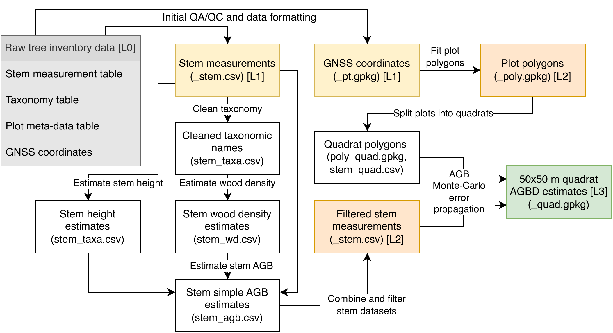

## Introduction

This purpose of this vignette is to demonstrate and document the complete
workflow for processing tree inventory data for the GEO-TREES initiative. The
code in this vignette matches the code in the R scripts elsewhere in this
repository. For automated processing of GEO-TREES tree inventory data it is
recommended to run the R scripts directly, not to use this vignette. This
vignette includes additional data visualisations to help understand how the
data is processed, and may provide a useful guide when processing a site for
the first time. Throughout the vignette there are sign-posts to the relevant R
script in the automated workflow.

Key steps of the workflow:

* Format raw field data to match the GEO-TREES L0 data format
* Align taxonomic names for each stem measurement
* Estimate height, wood density, and above-ground woody biomass of tree stems 
* Fit spatial polygons for each plot
* Calculate summary statistics of forest structure and biomass stocks within 50x50 m quadrats 


::: {#fig-flow fig-alt="GEO-TREES tree inventory processing workflow diagram." fig-align="center"}


Flow diagram of the GEO-TREES tree inventory processing workflow. Shaded boxes indicate core GEO-TREES data products (L1 = yellow, L2 = orange, L3 = green). Decisions on how data are analysed are taken at various stages of the processing chain: 1) stem height estimation, 2) wood density estimation, 3) stem AGB estimation, 4) stem filtering, 5) polygon fitting, 6) AGBD Monte-Carlo error propagation. Auxiliary field datasets can be included at multiple steps in this workflow, e.g.: local wood density, stem height measurements, crown dimensions (crown-distributed AGBD).
:::

This vignette uses an anonymised dataset, based on real data from a tropical
wet forest site in South America. To illustrate the use of all supported
auxiliary datasets and processing steps, some synthetic data have been
generated. 

Synthetic data are provided for:

* Locally-measured wood density estimates
* Locally-measured tree height estimates
* Local biomass and height allometries

## Setup

Required packages:

```{r}
#| label: setup
#| warning: false
#| message: false
#| results: hide
library(dplyr)  # Dataframe manipulation
library(tidyr)  # Reshape dataframes, e.g. pivot_wider()
library(sf)  # Spatial data 
library(BIOMASS)  # AGB estimation, H:D allometry, 
library(yaml)  # read_yaml() - Read YAML files with parameters
library(ggplot2)  # Create plots and graphs
library(rocrateR)  # rocrate() etc. - Create RO-Crate meta-data files
library(kableExtra)  # Print dataframes in Quarto documents, only for the vignette
```

Source additional functions:

```{r}
source("../../func.R")
```

```{r}
#| echo: false
#| tbl-cap: "Functions provided in `func.R` and their descriptions."
# Extract function descriptions
kable(extractRoxygen("../../func.R"))
```

Set data input and output directories:

```{r}
indir <- "./data-raw/data"
outdir <- "./out"

# Directory for files to check raw data and the results of each step, and
# tables and figures for site reports, as in the automated workflow
report_dir <- file.path(outdir, "report")
```

## Create L0 data

This part of the workflow will vary among sites, depending on the structure of
the raw field data. Consult the [GEO-TREES Tree Inventory Data Collection
Guidelines](https://docs.google.com/document/d/1Q5Wy_LbNEa0tNaGVntL0Bku41Z3t-TeU85_IxZuC6Uc/edit?usp=sharing)
Section 16: _Data format_ for information on the GEO-TREES L0 data format. [The
current repository](https://github.com/GEO-TREES/INV_processing) also contains
template files for formatting raw data, in the `./templates/` folder.

We provide various functions to help create valid GEO-TREES L0 data products:

* `pasteVals()` intelligently pastes values together, replacing NAs with blanks, useful for combining values in the `code` column.
* `colGen()` creates empty columns in a dataframe if they don't already exist, using a spec. table.
* `colCheck()` checks whether the columns in a dataframe exactly match those in a spec. table based on their name and class (e.g. numeric, character).
* `valCheck()` runs a series of simple logical checks on the different GEO-TREES Tree Inventory L0 data objects. 

You can see various examples of R scripts used to transform raw field data into
L0 data in `./sites/<SITE NAME>/<ACQUISITION ID>/01_fmt.R`.

::: {.callout-warning title="TODO"}
GEO-TREES also provides guidance on Quality Assurance and Quality Control of
tree inventory data.
:::

## Specify processing parameters

Choices made during the processing workflow, for example the choice to use a
local or regional height-diameter estimation method, should be specified in a
`param.yaml` YAML configuration file. This file also defines some site
meta-data and filepaths. 

There should be one `param.yaml` file for each version of the processed data.

`param.yaml` files should contain the following parameters:

* `site_id` -- Name of the site, e.g. `"Bicuar"`
* `acquisition_id` -- ID of data acquisition, e.g. `"2024"`
* `out_dir` -- Path to where processed data will be exported, e.g. `"./dat/sites/Bicuar/INV/2024/v1"`
* `raw_dir` -- Path to the raw input data, e.g. `"./dat/sites/Bicuar/INV/2024/L0"`
* `raw_version` -- Version of the raw input data, a sub-directory of `raw_dir`, e.g. `"v1"`. When raw data are corrected, create a new version so that previous outputs can still be reproduced
* `s3_dir` -- Optional, path to AWS S3 directory containing raw input data, e.g. `"johngodlee/GEO-TREES_INV/dat/sites/Amacayacu/INV/2024/L0"`
* `quad_dim` -- Dimensions in metres of quadrats, e.g. `[50, 50]` for 50x50 m square quadrats
* `opt_s3` -- Boolean (`true`/`false`). If `true`, raw input data will be pulled from an AWS S3 bucket specified in `s3_dir`, otherwise a local directory specified in `raw_dir`
* `product_version` -- String specifying the version of the data products, e.g. `"v1"`. Data products may be specified with different parameter sets, for example different size quadrats (`quad_dim`) or different methods of estimating stem height (`height_method`). 
* `software_version` -- String specifying the version of the code used to generate the data products, normally a GitHub release version, e.g. `"v2.4"`
* `height_method` -- Method used to estimate stem height: `"regional"` (Chave et al. 2014 Eq. 6a, with AGB from Eq. 7, which does not use height), `"field"` (a height-diameter model fitted to `height.csv`) or `"custom"` (a published height-diameter model given in `height_custom`). With `"field"` and `"custom"`, AGB is estimated with Chave et al. (2014) Eq. 4
* `wd_method` -- Method used to estimate wood density: `"regional"` (Global Wood Density Database v2), `"field"` (local measurements in `wd.csv`, replacing the Global Wood Density Database v2 estimates of the same taxa, with the Global Wood Density Database v2 for other taxa) or `"local"` (local measurements only, with genus, family and dataset means of the local species for taxa without a species estimate)
* `polygon_method` -- Method used to fit plot polygons, one of `"exact"`, `"affine"` or `"procrustes"`, see [Fit plot spatial polygons]
* `outside_max_dist_m` -- Maximum distance in metres outside the quadrat grid at which stems are assigned to the nearest quadrat, e.g. `5`. `0` excludes all stems outside the grid from quadrat summaries
* `corner_outlier_dist_m` -- Maximum distance in metres between a measured plot corner and the fitted plot polygon, beyond which the corner is treated as an outlier, e.g. `10`, see [Fit plot spatial polygons]
* `quad_grid_tol` -- Maximum proportion of the area of each plot which may be excluded from the grid of quadrats, e.g. `0.1`. The automated workflow centres the quadrat grid in each plot, so where the plot dimensions are not a multiple of the quadrat dimensions, equal strips along opposite edges of the plot are excluded, e.g. `0.4` allows 100 x 100 m quadrats in a 250 x 250 m plot, which excludes 36% of the plot
* `height_model` -- Height-diameter model used if `height_method` is `"field"`, one of `"best"` (lowest residual standard error), `"log1"`, `"log2"`, `"weibull"` or `"michaelis"`
* `agbd_diam_min_cm` -- Minimum stem diameter in cm for AGB density. The larger of this and the minimum diameter threshold of each plot is used, e.g. `0` uses the threshold of each plot
* `include_broken` -- `true` or `false`, whether stems broken above the POM are included in AGB density
* `multi_stem_method` -- How AGB is estimated for multi-stemmed trees, either `"equivalent"` (from the equivalent diameter of a single stem with the same basal area as the tree) or `"stem"` (from each stem separately)
* `unmapped_method` -- How trees without stem coordinates are treated, either `"random"` (assigned to a random quadrat in their plot in each Monte Carlo simulation) or `"exclude"` (excluded from AGB density)
* `diam_error` -- Diameter measurement error propagated to AGB, either `"chave2004"` (Chave et al. 2004), `"field"` (estimated from repeat diameter measurements in `stem_dup.csv` with `BIOMASS::fitDiamError()`), `"none"`, or a number giving the standard deviation of diameter measurement error in cm
* `quad_origin` -- Optional, alignment of the quadrat grid in each plot: `"centre"` (default) centres the grid in the plot, `"corner"` starts it at the origin corner of the plot, and `[x, y]` starts it x and y m from the origin corner. Where the plot dimensions are not a multiple of the quadrat dimensions, strips of the plot outside the grid are left out
* `missing_diam_method` -- Optional, how live stems without a diameter measurement are treated: `"impute"` (default) imputes their diameter in each Monte Carlo simulation from the other trees in the same plot, see [Missing measurements], or `"exclude"` excludes them
* `als_date` -- Optional, date of the airborne lidar acquisition matched to the plot data, `"YYYY-MM-DD"`, `"YYYY-MM"` or `"YYYY"`, used to report the time between the ALS acquisition and the census
* `taper_method` -- Optional, correction of diameters measured above 1.3 m to their equivalent at 1.3 m with an exponential taper model, used to estimate height and AGB: `"none"` (default), `"cushman2014"` (Cushman et al. 2014, Barro Colorado Island only) or `"cushman2021"` (Cushman et al. 2021, general model fitted at five lowland tropical forest sites). Palms are not corrected. Diameter thresholds use the measured diameter
* `taper_species` -- Optional, species terms of `"cushman2014"` by taxon name, e.g. `{"Ceiba pentandra": 0.0495}`
* `stem_allometry` -- Optional, `true` or `false` (default), whether stems use the AGB allometry in `agb_allometry` in the stem table, e.g. `"goodman2013"` for palms, see `agb_allometries` in `func.R`. Stems without one use Chave et al. (2014)
* `growth_form_exclude` -- Optional, values of `growth_form` in the stem table excluded from AGB density, e.g. `["strangler"]`. These stems have AGB estimates. None by default
* `height_custom` -- Required if `height_method` is `"custom"`, the height-diameter model: `formula`, height (m) as a function of diameter `D` (cm), e.g. `"a * D^b / (k + D^b)"`; `parameters`, e.g. `{a: 57.1, b: 0.73, k: 21.79}`; `sigma`, the residual standard deviation; `link`, `"log"` (default) if the residual error is log-normal and `formula` gives the median height, or `"identity"`; and `reference` 
* `crown_method` -- Optional, whether quadrat AGB density is also estimated with the AGB of each tree spread over its crown, see [Estimate quadrat AGBD and propagate error]: `"none"` (default) or `"custom"` (crown area from the allometry in `crown_custom`)
* `crown_custom` -- Required if `crown_method` is `"custom"`, the crown area allometry: `formula`, crown area (m^2^) as a function of diameter `D` (cm), e.g. `"a * D^b"`; `parameters`, e.g. `{a: 0.57, b: 1.34}`; `sigma`, the residual standard deviation; `link`, `"log"` (default) if the residual error is log-normal and `formula` gives the median crown area, or `"identity"`; and `reference`
* `rocrate` -- Information on who ran the workflow, used in the RO-Crate meta-data files which accompany each data product:
  * `author_name` -- e.g. `"John L. Godlee"`
  * `author_email` -- e.g. `"GodleeJ@si.edu"`
  * `author_orcid` -- Optional, ORCID URL of the author, e.g. `"https://orcid.org/0000-0000-0000-0000"`
  * `affiliation` -- e.g. `"Smithsonian Institution"`
  * `license` -- License file for the data products, e.g. `"TERMS.md"`

Import the example `param.yaml`:

```{r}
# Import param.yaml
# p <- yaml::read_yaml("./sites/<SITE>/<ACQUISITION>/<PRODUCTVERSION>/param.yaml")
p <- read_yaml(file.path(indir, "param.yaml"))

# Import software version
software_version <- read_yaml(file.path(indir, "version.yaml"))

# Merge parameters lists
param <- c(p, software_version)

# Define parameter names
param_name_vec <- c(
  "site_id",
  "acquisition_id",
  "quad_dim",
  "opt_s3",
  "s3_dir",
  "out_dir",
  "raw_dir",
  "raw_version",
  "height_method",
  "wd_method",
  "polygon_method",
  "outside_max_dist_m",
  "corner_outlier_dist_m",
  "quad_grid_tol",
  "height_model",
  "agbd_diam_min_cm",
  "include_broken",
  "multi_stem_method",
  "unmapped_method",
  "diam_error",
  "software_version",
  "product_version",
  "rocrate"
)

# Define optional parameter names
# `als_date` is the date of the airborne lidar acquisition matched to the
# plot data, YYYY-MM-DD, YYYY-MM or YYYY, used in 12_report.R
# `quad_origin` is the alignment of the quadrat grid in each plot, see
# ./07_quad.R: "centre" (default), "corner", or an offset [x, y] in metres
# from the origin corner of each plot
# `missing_diam_method` is how live stems without a diameter measurement are
# treated, see ./08_agb_mc.R: "impute" (default) or "exclude"
# `taper_method` is the correction of diameters measured away from 1.3 m to
# their equivalent at 1.3 m, see `taperB()` in ./func.R: "none" (default),
# "cushman2014" (Barro Colorado Island only) or "cushman2021"
# `taper_species` is the species terms of "cushman2014", by taxon name, e.g.
# {"Ceiba pentandra": 0.0495}. Other species use the base class
# `stem_allometry` is whether stems use the AGB allometry in `agb_allometry`
# in the stem table, see `agb_allometries` in ./func.R: false (default) or
# true
# `growth_form_exclude` is values of `growth_form` in the stem table excluded
# from AGB density, e.g. ["strangler"]. None by default
# `height_custom` is the height-diameter model used if `height_method` is
# "custom", see `heightCustom()` in ./func.R
# `crown_method` is whether quadrat AGB density is also estimated with tree
# AGB spread over crowns, see ./08_agb_mc.R: "none" (default) or "custom"
# `crown_custom` is the crown area allometry used if `crown_method` is
# "custom", see `crownCustom()` in ./func.R
param_optional_vec <- c(
  "als_date",
  "quad_origin",
  "missing_diam_method",
  "taper_method",
  "taper_species",
  "stem_allometry",
  "growth_form_exclude",
  "height_custom",
  "crown_method",
  "crown_custom"
)

# Define RO-Crate parameter names, `author_orcid` is optional
rocrate_name_vec <- c(
  "author_name",
  "author_email",
  "affiliation",
  "license"
)

# Check all parameters present
# `s3_dir` is only needed if `opt_s3` is TRUE
param_missing <- setdiff(param_name_vec, names(param))
if (isFALSE(param$opt_s3)) {
  param_missing <- setdiff(param_missing, "s3_dir")
}
if (length(param_missing) > 0) {
  stop("Missing parameters: ", paste(param_missing, collapse = ", "))
}

rocrate_missing <- setdiff(rocrate_name_vec, names(param$rocrate))
if (length(rocrate_missing) > 0) {
  stop("Missing `rocrate` parameters: ", paste(rocrate_missing, collapse = ", "))
}

param_extra <- setdiff(names(param), c(param_name_vec, param_optional_vec))
if (length(param_extra) > 0) {
  warning("Unrecognised parameters: ", paste(param_extra, collapse = ", "))
}

# Check parameter values
param_choices <- list(
  height_method = c("regional", "field", "custom"),
  wd_method = c("regional", "field", "local"),
  polygon_method = c("exact", "affine", "procrustes"),
  height_model = c("best", "log1", "log2", "weibull", "michaelis"),
  multi_stem_method = c("equivalent", "stem"),
  unmapped_method = c("random", "exclude")
)
for (i in names(param_choices)) {
  if (!param[[i]] %in% param_choices[[i]]) {
    stop("`", i, "` must be one of: ", paste(param_choices[[i]], collapse = ", "))
  }
}

if (length(param$quad_dim) != 2 || !is.numeric(param$quad_dim)) {
  stop("`quad_dim` must be two numbers, e.g. [50, 50]")
}

if (length(param$raw_version) != 1 || !grepl("^[A-Za-z0-9-]+$", param$raw_version)) {
  stop("`raw_version` must be a single version string, e.g. \"v1\", ",
    "without underscores or dots")
}

if (length(param$outside_max_dist_m) != 1 || !is.numeric(param$outside_max_dist_m) ||
  param$outside_max_dist_m < 0) {
  stop("`outside_max_dist_m` must be a number >= 0")
}

if (length(param$corner_outlier_dist_m) != 1 || !is.numeric(param$corner_outlier_dist_m) ||
  param$corner_outlier_dist_m <= 0) {
  stop("`corner_outlier_dist_m` must be a number > 0")
}

if (length(param$quad_grid_tol) != 1 || !is.numeric(param$quad_grid_tol) ||
  param$quad_grid_tol < 0 || param$quad_grid_tol >= 1) {
  stop("`quad_grid_tol` must be a number >= 0 and < 1")
}

if (length(param$agbd_diam_min_cm) != 1 || !is.numeric(param$agbd_diam_min_cm) ||
  param$agbd_diam_min_cm < 0) {
  stop("`agbd_diam_min_cm` must be a number >= 0")
}

if (length(param$include_broken) != 1 || !is.logical(param$include_broken) ||
  is.na(param$include_broken)) {
  stop("`include_broken` must be true or false")
}

if (length(param$diam_error) != 1 ||
  !(param$diam_error %in% c("chave2004", "field", "none") ||
    (is.numeric(param$diam_error) && param$diam_error > 0))) {
  stop("`diam_error` must be \"chave2004\", \"field\", \"none\", or a ",
    "number > 0, the standard deviation of diameter measurement error in cm")
}

if (is.null(param$quad_origin)) {
  param$quad_origin <- "centre"
}
if (is.null(param$missing_diam_method)) {
  param$missing_diam_method <- "impute"
}
if (!identical(param$missing_diam_method, "impute") && 
  !identical(param$missing_diam_method, "exclude")) {
  stop("`missing_diam_method` must be one of: impute, exclude")
}

if (is.null(param$taper_method)) {
  param$taper_method <- "none"
}
if (!param$taper_method %in% c("none", "cushman2014", "cushman2021")) {
  stop("`taper_method` must be one of: none, cushman2014, cushman2021")
}
if (!is.null(param$taper_species) && (!is.list(param$taper_species) ||
  is.null(names(param$taper_species)) ||
  !all(vapply(param$taper_species, is.numeric, logical(1))))) {
  stop("`taper_species` must be taxon names with numeric species terms, ",
    "e.g. {\"Ceiba pentandra\": 0.0495}")
}

if (is.null(param$stem_allometry)) {
  param$stem_allometry <- FALSE
}
if (length(param$stem_allometry) != 1 || !is.logical(param$stem_allometry) ||
  is.na(param$stem_allometry)) {
  stop("`stem_allometry` must be true or false")
}

param$growth_form_exclude <- unlist(param$growth_form_exclude)
if (length(param$growth_form_exclude) > 0 && !is.character(param$growth_form_exclude)) {
  stop("`growth_form_exclude` must be values of `growth_form`, e.g. [\"strangler\"]")
}

if (param$height_method == "custom") {
  if (is.null(param$height_custom) ||
    !all(c("formula", "parameters", "sigma") %in% names(param$height_custom))) {
    stop("`height_method` is \"custom\", so `height_custom` must give the ",
      "height-diameter model's `formula`, `parameters` and `sigma`")
  }
  # Check the model can be built
  invisible(heightCustom(param$height_custom))
}

if (is.null(param$crown_method)) {
  param$crown_method <- "none"
}
if (!param$crown_method %in% c("none", "custom")) {
  stop("`crown_method` must be one of: none, custom")
}
if (param$crown_method == "custom") {
  if (is.null(param$crown_custom)) {
    stop("`crown_method` is \"custom\", so `crown_custom` must give the ",
      "crown area allometry's `formula`, `parameters` and `sigma`")
  }
  # Check the allometry can be built
  invisible(crownCustom(param$crown_custom))
}
if (!(identical(param$quad_origin, "centre") || identical(param$quad_origin, "corner") ||
  (is.numeric(param$quad_origin) && length(param$quad_origin) == 2 && 
    all(param$quad_origin >= 0)))) {
  stop("`quad_origin` must be \"centre\", \"corner\", or two numbers >= 0, ",
    "the offset of the quadrat grid from the origin corner of each plot in m, e.g. [10, 10]")
}

if (!is.null(param$als_date)) {
  param$als_date <- as.character(param$als_date)
  if (length(param$als_date) != 1 || is.na(decDate(param$als_date))) {
    stop("`als_date` must be a single date: YYYY-MM-DD, YYYY-MM or YYYY")
  }
}

# Print parameters
param
```

If `opt_s3` is `true`, the `paws` package should be loaded to allow data data to be retrieved from an AWS S3 bucket. This is only relevant if data processing is happening on the [MAAP](https://docs.maap-project.org/en/hub/index.html) platform.

```{r}
# Optionally load AWS S3 package
if (param$opt_s3) {
  library(paws)
}
```

## Data structure 

GEO-TREES data products are organised in a strict directory hierarchy:

* SITE - The site name. Matches the `site_id` column in tree inventory datasets.
* DATATYPE - in this case "INV" tree inventory data. Alternatively, e.g. "ALS" (airborne laser scanning) or "TLS" (terrestrial laser scanning)
* ACQUISITION - The ID of the discrete period when L0 data was acquired in the field using a particular platform, normally including the date of acquisition in YYYY-MM-DD format. Where a L0 dataset was acquired over multiple days, prefer the mid-acquisition date. Tree inventory acquisitions are named by census year, i.e. the year of the mid-date of all stem measurements, in YYYY format.
* PRODUCT - Data product level, either:
  * "L0" - raw data 
  * "L1" - re-formatted raw data (raw instrument)
  * "L2" - model-derived products at matching resolution of L1 
  * "L3" - variables mapped to uniform space-time grid scales
* PRODUCTVERSION - Version of the code used to produce the data product, normally a GitHub release version of the code used to produce that data product.

Not all data products must utilise all levels of the directory hierarchy, and
certain products may include additional levels where specified, but the order
of the basic hierarchy does not change. This directory structure means that
sub-directory levels are never mixed within a parent directory. See below for a
breakdown of these levels:

Data product files are named according to the full directory hierarchy, with
levels separated by underscores (_), and a consistent suffix across files of a
given type within a product. Thus, hierarchy levels should not contain
underscores ("\_"). To prevent interference with file extensions, hierarchy
levels should also not contain dots (periods, "."). Both these characters
should be replaced with a hyphen ("-"). For example, for the tree inventory
(INV) L3 quadrat-level AGBD estimates for site "PanamaCanal", acquired on the
1st January 2025, processed using version 2.4 of the tree inventory processing
pipeline, using the v2 parameter set:

SITE: PanamaCanal
DATATYPE: INV
ACQUISITION: 2025-01-01
PRODUCTVERSION: v2
SOFTWAREVERSION: v2.4
PRODUCT: L3
File: quad

Directory path: PanamaCanal/INV/2025-01-01/v2/v2-4/L3/
Filename: PanamaCanal_INV_2025-01-01_v2_v2-4_L3_quad.gpkg

## Import L0 data

For convenience, we create a list `L0` where each element is a different L0
tree inventory data object. Column classes are taken from the column
templates in `./templates/`, so that e.g. an `acquisition_id` of `"2024"` is
read as a character string rather than a number.

```{r}
# Import column classes from column templates
colClass <- function(x) {
  cols <- read.csv(file.path("../../templates", paste0(x, "_cols.csv")))
  setNames(cols$class, cols$column_name)
}

# Import raw L0 data
L0 <- list(
  # Import stem measurements
  stem = read.csv(file.path(indir, "stem.csv"), colClasses = colClass("stem")),

  # Import plot meta-data
  plot = read.csv(file.path(indir, "plot.csv"), colClasses = colClass("plot")),

  # Import plot geo-location data
  pt = read.csv(file.path(indir, "pt.csv"), colClasses = colClass("pt")),

  # Import taxonomy data (optional)
  taxa = read.csv(file.path(indir, "taxa.csv"), colClasses = colClass("taxon")),

  # Import individual local wood density estimates (optional)
  wd = read.csv(file.path(indir, "wd.csv"), colClasses = colClass("wd")),

  # Import additional height-diameter measurements (optional)
  height = read.csv(file.path(indir, "hd.csv"), colClasses = colClass("height")),

  # Import field subplot bounds (optional)
  subplot = read.csv(file.path(indir, "subplot.csv"), colClasses = colClass("subplot"))
)
```

::: {.callout-warning title="TODO"}
```{r}
#| eval: false
# Import local biomass allometry
agb_allom <- readRDS(file.path(indir, "agb_allom.rds"))

# Import local height-diameter allometry
hd_allom <- readRDS(file.path(indir, "hd_allom.rds"))
```
:::

If you are on the MAAP platform and data is stored in an S3 bucket, use this
method to copy the files to a local directory first.

```{r}
# If S3, copy raw data from S3 bucket to local directory
if (param$opt_s3) {
  # Get object list from S3
  s3_client <- s3(region = "us-west-2")

  # Define S3 bucket where MAAP user directories are located
  # YOU MAY NEED CHANGE THIS
  bucket <- "maap-ops-workspace"

  # Identify files in dir_input
  s3_response <- s3_client$list_objects_v2(Bucket = bucket, Prefix = param$s3_dir)

  # Collect S3 paths from bucket
  shared_objects <- sapply(s3_response$Contents, "[[", "Key")

  # Check files detected
  if (length(shared_objects) == 0) { 
    stop("No raw data files detected in S3 bucket")
  }
  
  # Retrieve all files
  for (i in shared_objects) {
    # Construct new key in destination folder
    dest_key <- sub(param$s3_dir, param$raw_dir, i)

    # Copy files to local directory
    s3_client$download_file(Bucket = bucket, Key = i, Filename = dest_key)
  }
}
```

The stem measurement table contains one row per stem measurement. Stems may be
measured multiple times within a single census, for example if multiple
diameter measurements are collected at different Points of Measurement (POMs)
along the length of the stem.

The `record_id` column is a unique identifier for the stem measurement record
within the site, essentially the row number of the stem measurement table. 

The `measurement_date` column records the date of each measurement as a decimal
year, e.g. `2024.585` for 2nd August 2024, and `measurement_date_res` records
the resolution of the original date: `"YYYY-MM-DD"`, `"YYYY-MM"`, or `"YYYY"`.
The `decDate()` function converts dates to decimal years. Dates recorded only
to the month or year are placed at the middle of that month or year, e.g.
`decDate("2024")` returns `2024.5`.

```{r}
#| tbl-cap: "Example of L0 stem measurement table."
kable(head(L0$stem, 10))
```

The plot meta-data table contains one row per census per plot. It contains
additional information on field methodology, and qualitative information on
local environmental conditions and vegetation structure. These data are used
mostly for interpretation.

```{r}
#| tbl-cap: "Example of L0 plot meta-data table."
kable(L0$plot)
```

The plot geo-location table contains one row per location estimate of a single
survey point. Survey points may have multiple location estimates which are then
averaged when fitting the plot polygon. This table contains many columns
reserved for additional information provided when differential GNSS equipment
is used. In the example dataset these columns are blank ebcause the survey
points were collected with a single handheld GNSS unit. 

```{r}
#| tbl-cap: "Example of L0 plot geo-location measurements table."
kable(head(L0$pt, 5))
```

The optional taxa table contains additional taxonomic information. Each row is
a taxonomic name that features in the stem table, and columns contain corrected
taxonomic name information. This table is only used for interpretation. It is
useful in the case where codes or short-hand taxonomic names were used in the
field and those need to be linked with the full taxonomic name.

```{r}
#| tbl-cap: "Example of optional L0 taxa table."
kable(head(L0$taxa, 5))
```

The optional wood density table contains local field-measured wood density.
These measurements do not have to come from the plots, or even the same site,
but should be representative of the trees in the site. Each row is a taxonomic
name that features in the stem table. Where multiple wood density measurements
were collected for a single taxon, these should be aggregated to a mean,
standard deviation and the number of measurements.

```{r}
#| tbl-cap: "Example of optional L0 wood density estimates table."
kable(head(L0$wd, 5))
```

The optional stem height table contains local field-measured stem diameter and
height measurements. These measurements do not have to come from the plots, or
even the same site, but should be representative of the trees in the site. In
this case, the measurements were colelcted within the same site, but outside
the plots, hence the `site_id` column is filled, but the `plot_id` column is
filled with `NA` values.

```{r}
#| tbl-cap: "Example of optional L0 diameter-height measurements table."
kable(head(L0$height, 5))
```

::: {.callout-warning title="TODO"}
Local biomass allometry

Local height-diameter allometry
:::

Before processing, `valCheck()` runs a series of checks on the L0 data objects.
It returns an error for values which would cause the processing to fail, or
which are impossible, e.g. negative stem diameters, plot IDs which don't match
between tables, or values outside the ranges given in the template files in
`./templates/`. It returns a warning for values which are probably wrong, but
which may be legitimate, e.g. stems mapped far outside the plot, stems
without a `stem_id`, or field subplots which overlap, or which extend outside
the plot.

```{r}
# Check values in L0 data
valCheck(
  plot = L0$plot,
  stem = L0$stem,
  pt = L0$pt,
  taxon = L0$taxa,
  height = L0$height,
  wd = L0$wd,
  subplot = L0$subplot)
```

The example data have a diameter and coordinates for every stem. To show how
missing measurements are handled, see [Missing measurements], we remove the
diameter of 10 live stems, the coordinates of one stem in each of 10
multi-stemmed trees, and the coordinates of all stems of 20 trees. This is
for illustration only, and is not part of the processing workflow.

```{r}
# Remove some measurements, to illustrate how missing measurements are handled
set.seed(1)
live <- which(grepl("A", L0$stem$code) & grepl("S", L0$stem$code) & 
  !grepl("T|M", L0$stem$code))
L0$stem$diam_cm[sample(live, 10)] <- NA

tree_key_eg <- paste(L0$stem$plot_id, L0$stem$tree_id)
multi <- intersect(live, which(tree_key_eg %in% tree_key_eg[duplicated(tree_key_eg)]))
multi_one <- multi[!duplicated(tree_key_eg[multi])]
xy_na <- c(
  sample(multi_one, min(10, length(multi_one))),
  which(tree_key_eg %in% sample(unique(tree_key_eg[live]), 20)))
L0$stem[xy_na, c("x_rel_m", "y_rel_m")] <- NA
```

## Correct taxonomy 

`02_taxa.R`

Here we combine all the taxonomic names recorded across all the L0 data
objects, then use the `BIOMASS::correctTaxo()` function to query the 
[World Flora Online](https://www.worldfloraonline.org/) (WFO) API to find
matching taxonomic names in their database. 

The argument `interactive = TRUE` means that when a name matches multiple
taxonomic names in the WFO database, users will be prompted to pick the correct
taxonomic name from a list in the R console. In the automated workflow,
prompts are only shown in an interactive R session. When processing many sites
with `zz_site_all.R`, which sets `options(inv.batch = TRUE)`, ambiguous names
are left unmatched so that processing isn't interrupted. These names can be
matched in a later interactive run.

Example of the interactive dialogue returned by `correctTaxo()` for the name `"Julbernardia pan"`:

```
--- Pick a name ---
Matching string:        julbernardia pan
1   wfo-4000019655      Julbernardia    Pellegr.        accepted        Code/Plantae/Pteridobiotina/Angiosperms/Fabales/Fabaceae/Detarioideae/Julbernardia
2   wfo-0000169035      Julbernardia baumii     (Harms) Troupin synonym Code/Plantae/Pteridobiotina/Angiosperms/Fabales/Fabaceae/Detarioideae/Julbernardia/paniculata$Julbernardia/baumii
3   wfo-0000169220      Julbernardia paniculata (Benth.) Troupin        accepted        Code/Plantae/Pteridobiotina/Angiosperms/Fabales/Fabaceae/Detarioideae/Julbernardia/paniculata
4   wfo-0000169080      Julbernardia normandii  Pellegr.        synonym Code/Plantae/Pteridobiotina/Angiosperms/Fabales/Fabaceae/Detarioideae/Julbernardia/brieyi$Julbernardia/normandii
5   wfo-0000169069      Julbernardia brieyi     (De Wild.) Troupin      accepted        Code/Plantae/Pteridobiotina/Angiosperms/Fabales/Fabaceae/Detarioideae/Julbernardia/brieyi
6   wfo-0000169273      Julbernardia seretii    (De Wild.) Troupin      accepted        Code/Plantae/Pteridobiotina/Angiosperms/Fabales/Fabaceae/Detarioideae/Julbernardia/seretii
7   wfo-0000169317      Julbernardia unijugata  J.Léonard       accepted        Code/Plantae/Pteridobiotina/Angiosperms/Fabales/Fabaceae/Detarioideae/Julbernardia/unijugata
8   wfo-0000169251      Julbernardia pellegriniana      Troupin accepted        Code/Plantae/Pteridobiotina/Angiosperms/Fabales/Fabaceae/Detarioideae/Julbernardia/pellegriniana
9   wfo-0000169284      Julbernardia ogoouensis Pellegr.        synonym Code/Plantae/Pteridobiotina/Angiosperms/Fabales/Fabaceae/Detarioideae/Julbernardia/seretii$Julbernardia/ogoouensis
10  wfo-0000169673      Julbernardia polyphylla (Harms) Troupin synonym Code/Plantae/Pteridobiotina/Angiosperms/Fabales/Fabaceae/Detarioideae/Tetraberlinia/polyphylla$Julbernardia/polyphylla

> Enter a number to pick a row from the list, a valid WFO ID, 'N' for the next page, 'P' for the previous page, 'S' or press Enter to skip:
```

In the example dataset the taxonomic names are strings containing the genus,
species, any infra-specific epithets such as variety (`var.`) or subspecies (`subsp.`), or a
higher-order taxonomic rank such as just the genus or family. Some examples of valid names:

* "Burkea africana"
* "Pseudolachnostylis maprouneifolia var. glabra"
* "Quercus"
* "Fagaceae"

`correctTaxo()` also allows the user to pass separate `genus` and `species`
(species epithet) columns if your data is formatted that way.

If `useCache = TRUE`, `correctTaxo()` creates a cache object containing
previously queried taxonomic names, including the choices made during
interactive matching. In the automated workflow this cache is saved with the
raw data, to `wfo_cache.rds` in the directory containing `raw_dir`, e.g.
`./dat/sites/<SITE>/INV/<ACQUISITION>/wfo_cache.rds`. It is shared by all
product versions of an acquisition, as a record of the choices made. Names are matched in chunks, and the cache is saved after
each chunk, so choices are kept if interactive matching is interrupted. Names
which could not be matched in a batch run are not saved, so they are offered
again in the next interactive run.

```{r}
# Combine taxa across tables
taxon_vec <- sort(unique(c(
  L0$stem$taxon_name,
  L0$wd$taxon_name,
  L0$height$taxon_name)))

# Load WFO cache from previous processing
loadWFOCache(file.path(indir, "wfo_cache.rds"))

# Prompt the user only in interactive sessions
taxa_interactive <- interactive() && !isTRUE(getOption("inv.batch"))

# Match names in chunks, saving the cache after each chunk
# In the vignette the cache is saved to a temporary file
wfo_path <- file.path(tempdir(), "wfo_cache.rds")
chunk_size <- 25
taxon_chunks <- split(taxon_vec, ceiling(seq_along(taxon_vec) / chunk_size))
taxa_list <- list()
for (i in seq_along(taxon_chunks)) {
  taxa_list[[i]] <- BIOMASS::correctTaxo(
    genus = taxon_chunks[[i]], 
    species = NULL,
    interactive = taxa_interactive, 
    preferAccepted = TRUE,
    preferFuzzy = FALSE,
    sub_pattern = subPattern(),
    useCache = TRUE,
    useAPI = TRUE,
    capacity = 60,
    fill_time_s = 1, 
    timeout = 60)

  saveWFOCache(wfo_path, rm_empty = !taxa_interactive)
}
stem_taxa_all <- bind_rows(taxa_list)

# Fill the family of names without a matched family, e.g. stems identified
# only to family, from the optional taxon table, so that wood density can be
# estimated at family level
if (!is.null(L0$taxa)) {
  taxon_family <- trimws(L0$taxa$taxon_family[match(stem_taxa_all$nameOriginal, L0$taxa$taxon_name)])
  family_fill <- is.na(stem_taxa_all$familyAccepted) & !is.na(taxon_family) & taxon_family != ""
  stem_taxa_all$familyAccepted[family_fill] <- taxon_family[family_fill]
}
```

```{r}
#| tab-cap: "Example of output of `BIOMASS::correctTaxo()`."
# Inspect taxa table
kable(head(stem_taxa_all))
```

To make it easier to check the results, we create a table of names which were
changed (e.g. synonyms, spelling corrections) or which could not be matched,
with the method used to match each name and the number of stems affected. In
the automated workflow this table is written to `report/taxa_review.csv`. Methods
include `"AUTO"` (a single exact match), `"AUTO ACC"` (the only accepted name
among several candidates), `"MANUAL"` (picked by the user), `"SKIP"` (skipped
by the user), and `"EMPTY"` (no match found).

```{r}
#| tab-cap: "Names changed or not matched during taxonomic name matching."
# Create table of names which were changed or not matched, for review
taxa_method <- vapply(stem_taxa_all$nameSubmitted, function(x) { 
  m <- BIOMASS::getWFOCache()[[x]]$method
  if (is.null(m) || is.na(x)) NA_character_ else m
}, character(1), USE.NAMES = FALSE)

# Names are compared ignoring case and repeated whitespace
nameStd <- function(x) tolower(trimws(gsub("\\s+", " ", x)))

taxa_review <- stem_taxa_all %>%
  mutate(
    method = taxa_method,
    n_stem = as.vector(table(L0$stem$taxon_name)[nameOriginal]),
    n_stem = ifelse(is.na(n_stem), 0L, n_stem)) %>%
  filter(
    !is.na(nameOriginal), nameOriginal != "",
    is.na(nameAccepted) | nameStd(nameOriginal) != nameStd(nameAccepted)) %>%
  dplyr::select(nameOriginal, nameAccepted, familyAccepted, method, n_stem) %>%
  arrange(is.na(nameAccepted), desc(n_stem))

kable(head(taxa_review, 10))
```

We also summarise the outcome of name matching by the number of stems
affected, to check whether names which could not be matched affect many
stems. In the automated workflow this table is written to
`02_taxa/taxa_outcome.csv`, and used in the site report.

```{r}
#| tab-cap: "Outcome of taxonomic name matching, by number of names and stems."
# Summarise matching outcomes by number of stems
taxa_outcome <- stem_taxa_all %>%
  filter(!is.na(nameOriginal), nameOriginal != "") %>%
  mutate(
    n_stem = as.vector(table(L0$stem$taxon_name)[nameOriginal]),
    outcome = case_when(
      !is.na(nameAccepted) & nameStd(nameOriginal) == nameStd(nameAccepted) ~ "matched, unchanged",
      !is.na(nameAccepted) ~ "matched, changed",
      !is.na(familyAccepted) ~ "family only",
      TRUE ~ "not matched"),
    outcome = factor(outcome, levels = c("matched, unchanged",
      "matched, changed", "family only", "not matched"))) %>%
  group_by(outcome, .drop = FALSE) %>%
  summarise(n_name = n(), n_stem = sum(n_stem, na.rm = TRUE), .groups = "drop") %>%
  mutate(pct_stem = round(100 * n_stem / sum(n_stem), 1))

kable(taxa_outcome)
```

## Estimate stem wood density

`03_wd.R`

Here we estimate the wood density of each stem measurement using the
`BIOMASS::getWoodDensity()` function, which uses taxonomic names to extract
wood density estimates at species, genus, or family level. These estimates
are provided by BIOMASS, from models fitted to version 2 of the Global Wood
Density Database [@Zanne2009]. Stems of taxa which are not in the database
are given the mean wood density of their plot.

```{r}
# Join taxonomy data to stem data
taxa_all <- left_join(L0$stem, stem_taxa_all, by = c("taxon_name" = "nameOriginal"))
```

In the example dataset there are local field-measured wood density estimates
that we can use. For `getWoodDensity()` to use them we need to summarise
individual measurements to the mean and standard deviation of each taxon. We
summarise by the accepted taxonomic name, so that different original names
which refer to the same taxon are pooled. Measurements without a wood density
value are excluded.

```{r}
# Optionally process local wood density data
wd_summ <- L0$wd %>%
  left_join(., stem_taxa_all, by = c("taxon_name" = "nameOriginal")) %>% 
  filter(!is.na(genusAccepted), !is.na(wood_density_gcm3)) %>% 
  mutate(wood_density_n = ifelse(is.na(wood_density_n), 1, wood_density_n)) %>% 
  group_by(
    family = familyAccepted, 
    genus = genusAccepted, 
    species = speciesAccepted) %>%
  summarise(
    wood_density_n_total = sum(wood_density_n),
    meanWD = sum(wood_density_gcm3 * wood_density_n) / wood_density_n_total,
    sdWD = {
      # If SD is NA, treat as 0 (no variance) 
      # but still account distance from grand mean
      clean_sd = ifelse(is.na(wood_density_sd_gcm3), 0, wood_density_sd_gcm3)
      
      # Components for grand variance
      ss_within  = sum((wood_density_n - 1) * clean_sd^2)
      ss_between = sum(wood_density_n * (wood_density_gcm3 - meanWD)^2)
      
      # If wood_density_n_total <= 1, return NA; otherwise calculate SD
      if (wood_density_n_total > 1) {
        sqrt((ss_within + ss_between) / (wood_density_n_total - 1)) 
      } else {
        NA_real_
      }
    },
    .groups = "drop"
  ) %>% 
  dplyr::select(family, genus, species, meanWD, sdWD)
```

Then we estimate the wood density of each stem. Where a taxon has a local wood
density estimate with no standard deviation, e.g. from a single sample, and is
not in the Global Wood Density Database, we fill the missing standard
deviation with the mean standard deviation of other taxa estimated at the same
taxonomic level. Without a standard deviation, these stems would be dropped
from the AGB error propagation.

If `wd_method` is `"local"`, the Global Wood Density Database is not used.
Taxa without a local species estimate take the mean of the local species in
their genus, else in their family, where there are at least
`wd_local_min_sp` species, else the mean of all local species. Means are
taken over species, so that well-sampled species do not dominate, and the
standard deviation of a genus, family or dataset estimate is the standard
deviation among its species.

```{r}
# Estimate wood density for each stem measurement
# "regional" - Global Wood Density Database v2, with BIOMASS::getWoodDensity()
# "field" - local measurements, replacing GWDD v2 estimates of the same taxa,
#   with GWDD v2 for taxa without local measurements
# "local" - local measurements only
if (param$wd_method == "local") {
  wd_local_min_sp <- 2

  wd_sp <- wd_summ %>%
    filter(!is.na(species), species != "")
  # Mean and SD of species estimates in each genus or family
  wd_group <- function(level) {
    wd_sp %>%
      filter(!is.na(.data[[level]])) %>%
      group_by(group = .data[[level]]) %>%
      summarise(n_sp = n(), sdWD = sd(meanWD), meanWD = mean(meanWD),
        .groups = "drop") %>%
      filter(n_sp >= wd_local_min_sp)
  }
  wd_genus <- wd_group("genus")
  wd_family <- wd_group("family")

  i_sp <- match(paste(taxa_all$genusAccepted, taxa_all$speciesAccepted),
    paste(wd_sp$genus, wd_sp$species))
  i_gen <- match(taxa_all$genusAccepted, wd_genus$group)
  i_fam <- match(taxa_all$familyAccepted, wd_family$group)
  levelWD <- case_when(
    !is.na(i_sp) ~ "species",
    !is.na(i_gen) ~ "genus",
    !is.na(i_fam) ~ "family",
    TRUE ~ "dataset")
  wd_all <- data.frame(
    family = taxa_all$familyAccepted,
    genus = taxa_all$genusAccepted,
    species = taxa_all$speciesAccepted,
    stand = taxa_all$plot_id,
    meanWD = case_when(
      levelWD == "species" ~ wd_sp$meanWD[i_sp],
      levelWD == "genus" ~ wd_genus$meanWD[i_gen],
      levelWD == "family" ~ wd_family$meanWD[i_fam],
      TRUE ~ mean(wd_sp$meanWD)),
    sdWD = case_when(
      levelWD == "species" ~ wd_sp$sdWD[i_sp],
      levelWD == "genus" ~ wd_genus$sdWD[i_gen],
      levelWD == "family" ~ wd_family$sdWD[i_fam],
      TRUE ~ sd(wd_sp$meanWD)),
    levelWD = levelWD)
} else {
  wd_all <- BIOMASS::getWoodDensity(
    genus = taxa_all$genusAccepted,
    species = taxa_all$speciesAccepted,
    stand = taxa_all$plot_id,
    family = taxa_all$familyAccepted,
    addWoodDensityData = if (param$wd_method == "field") { wd_summ },
    verbose = TRUE)
}

# Check rows of output match stems
stopifnot(
  nrow(wd_all) == nrow(taxa_all),
  identical(as.character(wd_all$genus), as.character(taxa_all$genusAccepted)),
  identical(as.character(wd_all$species), as.character(taxa_all$speciesAccepted)))

# Fill missing wood density SD with the mean SD of other taxa estimated at the
# same level
sd_na <- is.na(wd_all$sdWD)
if (any(sd_na)) {
  sd_level <- wd_all %>% 
    filter(!is.na(sdWD)) %>% 
    distinct(genus, species, levelWD, sdWD) %>% 
    group_by(levelWD) %>% 
    summarise(sdWD_fill = mean(sdWD), .groups = "drop")
  sd_fill <- sd_level$sdWD_fill[match(wd_all$levelWD[sd_na], sd_level$levelWD)]
  sd_fill[is.na(sd_fill)] <- mean(sd_level$sdWD_fill)
  wd_all$sdWD[sd_na] <- sd_fill
}

# Create output dataframe
stem_wd_all <- cbind(record_id = taxa_all$record_id, wd_all)
```

```{r}
#| tab-cap: "Example of output of `BIOMASS::getWoodDensity()`."
# Inspect output
kable(head(stem_wd_all))
```

We summarise the taxonomic level at which wood density was estimated for
each stem. Estimates from the plot mean are used where a stem has no matched
genus or family. Many stems estimated at the family level or from the plot
mean may indicate problems with taxonomic names.

```{r}
#| tab-cap: "Wood density (g cm-3) by taxonomic level of the estimate."
# Summarise the taxonomic level of wood density estimates
wd_check <- stem_wd_all %>%
  mutate(level = ifelse(levelWD %in% c("species", "genus", "family", "dataset"),
    levelWD, "plot mean")) %>%
  mutate(level = factor(level, 
    levels = intersect(c("species", "genus", "family", "plot mean", "dataset"), level)))

wd_level <- wd_check %>%
  group_by(level) %>%
  summarise(
    n_stem = n(),
    meanWD_mean = mean(meanWD, na.rm = TRUE),
    meanWD_min = min(meanWD, na.rm = TRUE),
    meanWD_max = max(meanWD, na.rm = TRUE),
    .groups = "drop") %>%
  mutate(pct_stem = round(100 * n_stem / sum(n_stem), 1), .after = n_stem)

kable(wd_level, digits = 3)
```

```{r}
#| fig-cap: "Wood density estimates at each taxonomic level of the estimate, for stems used to estimate AGB density. Y-axis scales differ between levels."
#| fig-width: 8
#| fig-height: 7
# Figure of wood density at each taxonomic level of the estimate, for stems
# used to estimate AGB density, see `agbdFilter()` in func.R
record_agbd <- agbdFilter(L0$stem, L0$plot, 
  recordFilter(L0$stem, L0$plot, missing_diam = param$missing_diam_method == "impute"),
  diam_min_cm = param$agbd_diam_min_cm,
  include_broken = param$include_broken,
  growth_form_exclude = param$growth_form_exclude)
wd_fig <- filter(wd_check, as.character(record_id) %in% record_agbd)
wdLevelPlot(wd_fig$meanWD, wd_fig$level) +
  labs(
    title = "Wood density estimates by taxonomic level")
```

## Estimate stem height

`04_height.R`

Here we estimate the height of each stem measurement. Height estimates are
required for most stem AGB allometries.

There are multiple approaches to estimating stem height. In general, we
recommend this approach:

If there is an appropriate existing local height-diameter allometry, use that
to estimate the height of all stems in the site. A local height-diameter
allometry is deemed appropriate if the underlying data approximately span the
range of stem heights measured in the tree inventory data, the species
composition is similar to that found in the tree inventory data, and the local
conditions (water availability, temperature, topography) of the location where
the underlying data were collected are similar to that of the GEO-TREES site.

Otherwise if there is no existing local height-diameter allometry available, if
you have at least 50 local and reliable estimates of stem height and diameter,
spanning the range of stem size across the plots, fit a local height-diameter
allometry using the `BIOMASS::modelHD()` function.

Finally, if neither of the above are appropriate, use the
`BIOMASS::retrieveH()` function and supply plot coordinates to estimate stem
height from a regional height-diameter allometry [@Chave2014].

Height-diameter and AGB allometries use the diameter at 1.3 m. Where the
diameter of buttressed or irregular stems was measured higher up, the diameter
at 1.3 m can optionally be estimated with an exponential taper model, $d = D
e^{-b(h - 1.3)}$, where $d$ is the diameter measured at height $h$ and $D$ is
the diameter at 1.3 m, set by `taper_method`. `"cushman2014"` uses the model
of @Cushman2014 for Barro Colorado Island, Panama, with optional species terms
in `taper_species`. `"cushman2021"` uses the general model of @Cushman2021,
fitted at five lowland tropical forest sites, without its site effect. Only
stems measured above 1.3 m are corrected, as the taper models were fitted to
stems measured above buttresses, and palms are not corrected. The corrected
diameter is used to estimate height and AGB, while the measured diameter,
`diam_cm_meas`, is used for diameter thresholds, as the plots were sampled on
measured diameters. The example data use the default, `"none"`.

```{r}
# Diameter at 1.3 m, corrected for taper, see `taper_method` in param.yaml
# and `taperB()` in func.R. Stems without a POM were measured at the default
# POM of the plot
stem_taper <- L0$stem
stem_taper$diam_cm_meas <- stem_taper$diam_cm
if (param$taper_method != "none") {
  hom <- coalesce(stem_taper$pom_m,
    L0$plot$meas_pom_default_m[match(stem_taper$plot_id, L0$plot$plot_id)])
  wd_i <- match(stem_taper$record_id, stem_wd_all$record_id)
  palm <- stem_wd_all$family[wd_i] %in% "Arecaceae"
  sp_term <- unlist(param$taper_species)[
    paste(stem_wd_all$genus[wd_i], stem_wd_all$species[wd_i])]
  sp_term[is.na(sp_term)] <- 0
  b <- taperB(stem_taper$diam_cm, hom, param$taper_method,
    wd = stem_wd_all$meanWD[wd_i], sp_term = sp_term)
  taper_corr <- !palm & !is.na(stem_taper$diam_cm) & !is.na(hom) & hom > 1.3 + 1e-6
  stem_taper$diam_cm[taper_corr] <- stem_taper$diam_cm[taper_corr] /
    exp(-b[taper_corr] * (hom[taper_corr] - 1.3))
}
```

Where an existing local height-diameter allometry is available
(`height_method: "custom"`), it is given in `height_custom`, and built with
`BIOMASS::customHD()`, through `heightCustom()` in `func.R`. Its residual
error, `sigma`, is propagated to AGB in [Estimate quadrat AGBD and propagate
error]. With `link: "log"`, the residual error is log-normal, `formula` gives
the median height, and `retrieveH()` returns the mean height. The example data
have no local allometry, so here we use the model of @MartinezCano2019 for
Barro Colorado Island to illustrate:

```{r}
# Published height-diameter model, see `height_custom` in param.yaml
height_custom <- if (!is.null(param$height_custom)) {
  param$height_custom
} else {
  list(
    formula = "a * D^b / (k + D^b)",
    parameters = list(a = 57.1, b = 0.73, k = 21.79),
    sigma = 0.181,
    link = "log",
    reference = "Martinez-Cano et al. (2019)")
}
height_mod_custom <- heightCustom(height_custom)
height_mod_custom

# Predict mean height. For a model with log-normal error, the RSE is on the
# log scale
height_est_custom <- retrieveH(
  D = stem_taper$diam_cm,
  model = height_mod_custom)

# Create output dataframe, if `height_method` is "custom"
if (param$height_method == "custom") {
  stem_height_all <- stem_taper %>%
    mutate(
      height_m_pred = height_est_custom$H,
      height_m_pred_rse = height_est_custom$RSE) %>%
    dplyr::select(record_id, height_m_pred, height_m_pred_rse)
}
```


Where sufficient local height data are available:

```{r}
#| fig-cap: "Fitted height-diameter models of different forms."
# Compare height diameter models
height_mod_comp <- modelHD(
  D = L0$height$diam_cm,
  H = L0$height$height_m,
  bayesian = FALSE,
  useCache = FALSE,
  drawGraph = TRUE)
```

```{r}
#| tab-cap: "Example of output of `BIOMASS::modelHD() model fit comparison table`."
# Inspect tabular output of modelHD()
kable(height_mod_comp)
```

```{r}
# Choose height diameter model, set by `height_model`. If "best", use the
# model with the lowest residual standard error, calculated on the
# untransformed height scale for all models, so comparable across log and
# non-log models
height_mod_best <- if (param$height_model == "best") {
  height_mod_comp$method[which.min(height_mod_comp$RSE)]
} else {
  param$height_model
}

# Fit best height diameter model
height_mod <- modelHD(
  D = L0$height$diam_cm,
  H = L0$height$height_m,
  method = height_mod_best,
  bayesian = FALSE,
  useCache = FALSE,
  drawGraph = FALSE)

# Predict with best height diameter model
height_est <- retrieveH(
  D = stem_taper$diam_cm,
  model = height_mod)

# Create output dataframe, if `height_method` is "field"
if (param$height_method == "field") {
  stem_height_all <- stem_taper %>% 
    mutate(
      height_m_pred = height_est$H,
      height_m_pred_rse = height_est$RSE) %>% 
    dplyr::select(record_id, height_m_pred, height_m_pred_rse)
}
```

We choose the model with the lowest residual standard error (RSE). Note that
`Average_bias` is signed, so choosing the model with the lowest
`Average_bias` would choose the model which most underestimates stem height.

Alternatively using a regional height-diameter allometry where no height data
are available. `retrieveH()` estimates height from Equation 6a of
@Chave2014, using an index of environmental stress (E) at the centre of each
plot. The residual standard error of this model (0.243) is on the log scale,
so it is not a standard deviation of height in metres.

```{r}
# Extract plot centres
plot_pt_split <- L0$pt %>% 
  filter(!is.na(rover_easting_utm_m), !is.na(rover_northing_utm_m)) %>% 
  split(., .$crs_epsg)
p_cent <- bind_rows(lapply(plot_pt_split, function(x) { 
  st_as_sf(x, coords = c("rover_easting_utm_m", "rover_northing_utm_m"), 
    crs = unique(x$crs_epsg)) %>% 
  st_transform(., 4326) 
})) %>% 
group_by(site_id, plot_id) %>% 
summarise() %>% 
st_centroid() %>% 
cbind(., st_coordinates(.)) %>% 
st_drop_geometry() %>% 
dplyr::select(plot_id, X, Y)

# Add plot centres to stem data
s_cent <- stem_taper %>% 
  left_join(., p_cent, by = "plot_id")

stopifnot(all(!is.na(s_cent$X)))
stopifnot(all(!is.na(s_cent$Y)))

# Retrieve stem heights using plot locations
height_pred <- retrieveH(
  D = s_cent$diam_cm, 
  coord = s_cent[,c("X", "Y")])

# RSE of Chave et al. (2014) Eq. 6a, on the log scale
# NOTE: not a standard deviation in metres, do not pass to AGBmonteCarlo(errH = )
height_pred$RSE <- rep(0.243, length(height_pred$H))

s_cent$height_m_pred <- height_pred$H
s_cent$height_m_pred_rse <- height_pred$RSE

# Create output dataframe, if `height_method` is "regional"
if (param$height_method == "regional") {
  stem_height_all <- s_cent %>% 
    dplyr::select(record_id, height_m_pred, height_m_pred_rse)
}
```

We summarise the predicted stem heights. Heights over 60 m are rare, and may
indicate errors in stem diameter.

```{r}
#| tab-cap: "Summary of predicted stem height."
# Height-diameter model used to estimate AGB, if `height_method` is "custom"
if (param$height_method == "custom") {
  height_mod <- height_mod_custom
}

# Summarise predicted heights
height_check <- stem_taper %>%
  dplyr::select(record_id, plot_id, diam_cm) %>%
  inner_join(., stem_height_all, by = "record_id") %>%
  filter(!is.na(diam_cm), !is.na(height_m_pred))

height_summ <- height_check %>%
  summarise(
    n_stem = n(),
    height_m_min = min(height_m_pred),
    height_m_median = median(height_m_pred),
    height_m_max = max(height_m_pred),
    n_over_60m = sum(height_m_pred > 60))

kable(height_summ, digits = 2)
```

```{r}
#| fig-cap: "Stem height against diameter: measured heights, and predicted heights for stems used to estimate AGB density, drawn on top."
#| fig-width: 8
#| fig-height: 6
# Figure of stem height against diameter, for stems used to estimate AGB
# density, see `agbdFilter()` in func.R. Measured heights are from the
# height table, or from the stem table if there is no height table. 
# Predicted heights are drawn on top of measured heights
height_pred_fig <- filter(height_check, as.character(record_id) %in% record_agbd)
height_obs <- if (!is.null(L0$height)) {
  filter(L0$height, !is.na(diam_cm), !is.na(height_m))
} else {
  filter(L0$stem, !is.na(diam_cm), !is.na(height_m))
}
p_height <- ggplot()
if (nrow(height_obs) > 0) {
  p_height <- p_height +
    geom_point(data = height_obs, aes(x = diam_cm, y = height_m, colour = "Measured"),
      size = 0.8, alpha = 0.5, shape = 16)
}
p_height <- p_height +
  geom_point(data = height_pred_fig, aes(x = diam_cm, y = height_m_pred, 
    colour = "Predicted"), size = 0.6, alpha = 0.3, shape = 16)
if (param$height_method == "field") {
  height_curve <- data.frame(diam_cm = seq(min(height_obs$diam_cm), 
    max(height_obs$diam_cm), length.out = 200))
  height_curve$height_m <- retrieveH(D = height_curve$diam_cm, model = height_mod)$H
  p_height <- p_height +
    geom_line(data = height_curve, aes(x = diam_cm, y = height_m, 
      colour = "Fitted model"), linewidth = 0.7)
}
p_height +
  scale_colour_manual(NULL, 
    values = c("Measured" = fig_pal$series[2], "Predicted" = fig_pal$series[1], 
      "Fitted model" = fig_pal$ink),
    breaks = c("Measured", "Predicted", "Fitted model")) +
  guides(colour = guide_legend(override.aes = list(alpha = 1, size = 2))) +
  labs(
    title = "Stem height against diameter",
    x = "Diameter (cm)", 
    y = "Height (m)") +
  themeFig()
```

## Estimate stem AGB 

`05_agb_stem.R`

Here we estimate the above-ground woody biomass (AGB, `agb_Mg`) of each stem
measurement using the `BIOMASS::computeAGB()` function, which returns the AGB
of each tree in Mg. Where heights come from a local
height-diameter model, fitted to the height data (`height_method: "field"`) or
published (`height_method: "custom"`), Equation 4 from @Chave2014
is used to estimate AGB with stem diameter (`D`), stem height (`H`), and wood
density (`WD`). Where no local height data are available (`height_method:
"regional"`), Equation 7 from @Chave2014 is used, which replaces stem height
with an index of environmental stress at the plot centre. This matches the
allometry used in the AGB error propagation in [Estimate quadrat AGBD and
propagate error], so that stem-level and quadrat-level estimates are
consistent. Because the @Chave2014 model
was fitted using mostly data from tropical wet forests, it may fail to
accurately capture the relationship between stem diameter, height, and volume
in other vegetation types. For these sites, a local AGB allometry may be more
appropriate. 

You may also choose to have different AGB allometries for different functional
groups in the tree inventory data. For example, if there are large baobab trees
(_Adansonia_ sp.), bamboos, palms, or lianas which have drastically different
physiognomy to other trees in the dataset. If `stem_allometry` is `true`, each
tree uses the allometry in `agb_allometry` of its largest stem in the stem
table, one of `agb_allometries` in `func.R`, e.g. `"goodman2013"`, the palm
allometry of @Goodman2013. Trees without one use @Chave2014. Each allometry in
`agb_allometries` is given in the format of the `fitted_allom` argument of
`BIOMASS::AGBmonteCarlo()`, as a formula of `D`, `H` and `WD`, its parameters
and residual standard deviation, and a link, so that its residual error is
propagated in [Estimate quadrat AGBD and propagate error]. Here, with a log
link, `agbAllomMean()` gives the mean of the log-normal distribution of AGB.
The example data do not use stem allometries.

Diameters are corrected for taper if `taper_method` is set, see [Estimate
stem height]. Basal area is calculated from the measured diameter.

Where trees have multiple stems, AGB is estimated for the tree from its
equivalent diameter, $D_{eq} = \sqrt{\sum D_i^2}$, the diameter of a single
stem with the same basal area as all its stems. Estimating AGB for each stem
separately would underestimate the AGB of multi-stemmed trees, because AGB
increases more than proportionally with stem diameter. Tree AGB is then shared
among its stems in proportion to their basal area. Trees are formed from the
stems used to estimate AGB density (see [Filter stem data]), grouped by
`tree_id` within each plot, using `recordFilter()`, `agbdFilter()` and
`treeEquiv()` from `func.R`. Other stems, e.g. dead stems, and stems below the
minimum diameter threshold of the plot, are treated as single-stemmed trees.
Wood density depends on taxonomic identity, which is the same for all stems of
a tree, so the wood density of the largest stem is used.

We also create some additional variables like stem basal area (`ba_m2`) and
stem volume (`volume_m3`).

```{r}
# Stems which form multi-stemmed trees. If `multi_stem_method` is "stem", AGB
# is estimated for each stem separately
record_agbd <- agbdFilter(stem_taper, L0$plot, 
  recordFilter(stem_taper, L0$plot, missing_diam = param$missing_diam_method == "impute"),
  diam_min_cm = param$agbd_diam_min_cm,
  include_broken = param$include_broken,
  growth_form_exclude = param$growth_form_exclude)
tree_include <- if (param$multi_stem_method == "equivalent") record_agbd else character(0)

# Join wood density, height, and equivalent diameter to stem data. Diameters
# are corrected for taper, see `taper_method`
stem_all <- stem_taper %>%
  left_join(., stem_wd_all, by = "record_id") %>%
  left_join(., stem_height_all, by = "record_id") %>%
  left_join(., treeEquiv(stem_taper, tree_include), by = "record_id")

# One row per tree. Wood density depends on taxonomic identity, which is the
# same for all stems of a tree, so the wood density of the largest stem is used
tree <- stem_all %>%
  arrange(desc(ba_share)) %>%
  group_by(tree_key) %>%
  summarise(
    plot_id = first(plot_id),
    diam_eq_cm = first(diam_eq_cm),
    meanWD = first(meanWD),
    agb_allometry = if (param$stem_allometry) first(agb_allometry) else NA_character_,
    n_taxa = n_distinct(taxon_name),
    .groups = "drop") %>%
  mutate(agb_allometry = coalesce(na_if(agb_allometry, ""), "chave2014"))

allom_unknown <- setdiff(tree$agb_allometry, c("chave2014", names(agb_allometries)))
if (length(allom_unknown) > 0) {
  stop("Unknown `agb_allometry` in the stem table: ", 
    paste(allom_unknown, collapse = ", "), ". Must be one of: ",
    paste(c("chave2014", names(agb_allometries)), collapse = ", "))
}

if (any(tree$n_taxa > 1)) {
  warning(sum(tree$n_taxa > 1), " multi-stemmed trees have stems with ",
    "different taxonomic names. The wood density of the largest stem is used",
    call. = FALSE)
}

# Estimate tree-level AGB
# computeAGB() returns a vector of tree AGB in Mg. Stems without a diameter,
# see `missing_diam_method` in param.yaml, have no AGB estimate here. Their 
# diameters are imputed during AGB error propagation
muffleNA <- function(w) {
  if (grepl("NA values in D", conditionMessage(w))) invokeRestart("muffleWarning")
}
if (param$height_method == "regional") {
  tree <- left_join(tree, p_cent, by = "plot_id")
  stopifnot(all(!is.na(tree$X)))
  tree$agb_Mg <- withCallingHandlers(BIOMASS::computeAGB(
    D = tree$diam_eq_cm,
    WD = tree$meanWD,
    coord = as.matrix(tree[, c("X", "Y")])), warning = muffleNA)
} else if (param$height_method %in% c("field", "custom")) {
  tree$agb_Mg <- withCallingHandlers(BIOMASS::computeAGB(
    D = tree$diam_eq_cm,
    WD = tree$meanWD,
    H = retrieveH(D = tree$diam_eq_cm, model = height_mod)$H), warning = muffleNA)
}

# Trees with other allometries, see `stem_allometry`
for (a in intersect(names(agb_allometries), tree$agb_allometry)) {
  i <- which(tree$agb_allometry == a)
  tree$agb_Mg[i] <- agbAllomMean(agb_allometries[[a]],
    D = tree$diam_eq_cm[i],
    H = if (param$height_method != "regional") retrieveH(D = tree$diam_eq_cm[i], model = height_mod)$H,
    WD = tree$meanWD[i])
}

# Share tree AGB among stems
stem_agb_all <- stem_all %>%
  mutate(
    agb_Mg = tree$agb_Mg[match(tree_key, tree$tree_key)] * ba_share,
    # Basal area from the measured diameter
    ba_m2 = base::pi * (diam_cm_meas / 2)^2 / 10000,
    volume_m3 = agb_Mg / meanWD) %>%
  dplyr::select(
    record_id,
    agb_Mg,
    ba_m2,
    volume_m3)
```

```{r}
#| fig-cap: "Histogram of stem-level Above-ground woody biomass (AGB) estimates."
# Visualise distribution of stem-level AGB
ggplot(stem_agb_all, aes(x = agb_Mg)) + 
  geom_histogram(colour = "black", fill = "grey", binwidth = 1, boundary = 0) + 
  theme_bw() + 
  labs(
    x = "Above-ground woody biomass (Mg)",
    y = "N stems")
```

We summarise the AGB of stems used to estimate AGB density in each plot,
using the nominal plot area, and list the trees with the largest AGB, which
may indicate data errors, e.g. diameters in mm rather than cm. Quadrat-level
AGB density, from the fitted plot polygons, is estimated in [Estimate
quadrat AGBD and propagate error].

```{r}
#| tab-cap: "AGB density in each plot, using nominal plot area."
# Summarise AGB of stems used to estimate AGB density in each plot
agb_plot <- L0$stem %>%
  dplyr::select(record_id, plot_id) %>%
  inner_join(., stem_agb_all, by = "record_id") %>%
  filter(as.character(record_id) %in% record_agbd) %>%
  group_by(plot_id) %>%
  summarise(
    n_stem = n(),
    agb_Mg = sum(agb_Mg, na.rm = TRUE),
    ba_m2 = sum(ba_m2, na.rm = TRUE),
    .groups = "drop") %>%
  # Plots with no stems used to estimate AGB density have zero AGB
  right_join(., dplyr::select(L0$plot, plot_id, plot_length_m, plot_width_m), 
    by = "plot_id") %>%
  mutate(
    across(c(n_stem, agb_Mg, ba_m2), ~ifelse(is.na(.x), 0, .x)),
    area_ha = plot_length_m * plot_width_m / 10000,
    agbd_Mg_ha = agb_Mg / area_ha,
    ba_m2_ha = ba_m2 / area_ha) %>%
  dplyr::select(plot_id, n_stem, area_ha, agb_Mg, agbd_Mg_ha, ba_m2_ha) %>%
  arrange(desc(agbd_Mg_ha))

kable(agb_plot, digits = 2)
```

```{r}
#| tab-cap: "Trees with the largest AGB."
# Largest trees, which may indicate data errors, e.g. diameter in mm not cm
tree_large <- tree %>%
  filter(!is.na(agb_Mg)) %>%
  arrange(desc(agb_Mg)) %>%
  head(10) %>%
  dplyr::select(tree_key, plot_id, diam_eq_cm, meanWD, agb_Mg)

kable(tree_large, digits = 3)
```

```{r}
#| fig-cap: "Tree AGB against diameter, on log scales, using the equivalent diameter of multi-stemmed trees. Points far from the main cloud may be data errors."
#| fig-width: 8
#| fig-height: 6
# Figure of tree AGB against equivalent diameter
tree_check <- filter(tree, !is.na(agb_Mg), agb_Mg > 0, diam_eq_cm > 0)
p_agb <- ggplot(tree_check, aes(x = diam_eq_cm, y = agb_Mg)) +
  geom_point(colour = fig_pal$series[1], size = 0.6, alpha = 0.3, shape = 16) +
  scale_x_log10() +
  scale_y_log10() +
  labs(
    title = "Tree AGB against diameter",
    x = "Diameter (cm)",
    y = "AGB (Mg)") +
  themeFig()
p_agb
```

```{r}
#| fig-cap: "Share of AGB in each 10 cm diameter class, for trees used to estimate AGB density, using the equivalent diameter of multi-stemmed trees. Numbers above the bars are the number of trees in each class."
#| fig-width: 8
#| fig-height: 5
# Figure of the share of AGB in each diameter class, for trees used to
# estimate AGB density, all plots. Classes from `diam_class_max_cm` upwards
# are combined
diam_class_cm <- 10
diam_class_max_cm <- 150
tree_agbd <- tree %>%
  filter(tree_key %in% stem_all$tree_key[as.character(stem_all$record_id) %in% record_agbd],
    !is.na(agb_Mg))
diam_class <- tree_agbd %>%
  mutate(diam_class = pmin(floor(diam_eq_cm / diam_class_cm) * diam_class_cm, 
    diam_class_max_cm)) %>%
  group_by(diam_class) %>%
  summarise(n_tree = n(), agb_Mg = sum(agb_Mg), .groups = "drop") %>%
  mutate(
    pct_agb = 100 * agb_Mg / sum(agb_Mg),
    label = ifelse(diam_class == diam_class_max_cm, paste0(diam_class_max_cm, "+"),
      paste0(diam_class, "-", diam_class + diam_class_cm)),
    label = factor(label, levels = label))
p_diam_class <- ggplot(diam_class, aes(x = label, y = pct_agb)) +
  geom_col(fill = fig_pal$series[1], width = 0.8) +
  geom_text(aes(label = format(n_tree, big.mark = ",", trim = TRUE)),
    vjust = -0.4, size = 3, colour = fig_pal$ink_muted) +
  scale_y_continuous(expand = expansion(mult = c(0, 0.1))) +
  labs(
    title = "Share of AGB by diameter class",
    x = "Diameter class (cm)",
    y = "Share of AGB (%)") +
  themeFig() +
  theme(axis.text.x = element_text(angle = 45, hjust = 1))
p_diam_class
```

::: {.callout-warning title="TODO"}
Where a local biomass allometry is available:

```{r}
```
:::

## Filter stem data 

`06_record_fil.R`

Here we filter the tree inventory data prior to estimating above-ground biomass
density in each 50x50 m quadrat. 

We apply the following filters:

* Remove stems with no diameter measurement, if `missing_diam_method` is `"exclude"`. 
* Include only living stems.
* Include only standing stems.
* Remove stems that are broken below the diameter Point of Measurement (POM). Stems broken above the POM are included.
* Remove "missing" stems. I.e. stems which were not measured during the census.
* Where stems were measured multiple times at multiple POMs, choose the measurement with a diameter, then the highest POM, latest measurement date, and largest diameter measurement. Stems without a `stem_id` cannot be matched across measurements, so each of their records is treated as a separate stem.

Stems with a diameter below the minimum diameter threshold of the plot have
their own AGB estimates, but are not part of multi-stemmed trees, and are
excluded when AGB is summed to estimate AGB density, so that AGB density
matches the sampling of the plot. Stems without a diameter are assumed to be
at or above the threshold, as they were recorded in the census. The threshold
applies to the measured diameter, not the diameter corrected for taper. Stems
of growth forms listed in `growth_form_exclude`, from `growth_form` in the
stem table, e.g. strangler figs, whose stems are fused around a host tree,
are also excluded from AGB density.

```{r}
# Select stems used to estimate AGB, see `recordFilter()` in func.R
# Stems without coordinates are kept, and are placed at random during AGB 
# error propagation. If `missing_diam_method` is "impute", stems without a 
# diameter are kept, and their diameters are imputed during AGB error 
# propagation
record_fil <- recordFilter(L0$stem, L0$plot, 
  missing_diam = param$missing_diam_method == "impute")

# Select stems used to estimate AGB density, see `agbdFilter()` in func.R
# Stems below the minimum diameter threshold, the larger of
# `agbd_diam_min_cm` and the threshold of the plot, are excluded. Stems broken
# above the POM are excluded if `include_broken` is false, and stems of growth
# forms in `growth_form_exclude` are excluded
record_agbd <- agbdFilter(L0$stem, L0$plot, record_fil,
  diam_min_cm = param$agbd_diam_min_cm,
  include_broken = param$include_broken,
  growth_form_exclude = param$growth_form_exclude)
```

We summarise why stem records are excluded from AGB estimates and AGB
density. Each record is counted once, under the first reason which applies,
in the order of the checks in `recordFilter()` and `agbdFilter()`. "AGB
only" stems have AGB estimates, but are not included in AGB density.

```{r}
#| tab-cap: "Stem records used to estimate AGB and AGB density, and reasons for excluding records."
# Summarise why stem records are excluded from AGB estimates and AGB density
diam_min <- pmax(L0$plot$meas_diam_min_cm[match(L0$stem$plot_id, L0$plot$plot_id)],
  param$agbd_diam_min_cm)
record_status <- L0$stem %>%
  mutate(
    status = case_when(
      as.character(record_id) %in% record_agbd & is.na(diam_cm) ~ 
        "included in AGB density, diameter imputed",
      as.character(record_id) %in% record_agbd ~ "included in AGB density",
      is.na(code) | code == "" ~ "excluded: no code",
      grepl("M", code) ~ "excluded: missing",
      !grepl("A", code) ~ "excluded: dead",
      !grepl("S", code) ~ "excluded: not standing",
      grepl("T", code) ~ "excluded: broken below POM",
      is.na(diam_cm) ~ "excluded: no diameter",
      !as.character(record_id) %in% record_fil ~ "excluded: repeat measurement of stem",
      !is.na(diam_min) & !is.na(diam_cm) & diam_cm < diam_min ~ 
        "AGB only: below diameter threshold",
      grepl("B", code) & !param$include_broken ~ "AGB only: broken above POM",
      growth_form %in% param$growth_form_exclude ~
        paste0("AGB only: excluded growth form (", growth_form, ")"),
      TRUE ~ "AGB only: other")) %>%
  count(status, name = "n_record") %>%
  mutate(pct_record = round(100 * n_record / sum(n_record), 1)) %>%
  arrange(desc(grepl("^included", status)), desc(n_record))

kable(record_status)
```

```{r}
#| fig-cap: "Diameter of stems used to estimate AGB density, all plots, in 5 cm classes."
#| fig-width: 8
#| fig-height: 5
# Figure of the diameter of stems used to estimate AGB density, all plots.
# Stems without a diameter are not shown
diam_hist_cm <- 5
ggplot(filter(L0$stem, as.character(record_id) %in% record_agbd, !is.na(diam_cm)), 
  aes(x = diam_cm)) +
  geom_histogram(binwidth = diam_hist_cm, boundary = min(diam_min, na.rm = TRUE),
    fill = fig_pal$series[1], colour = fig_pal$surface, linewidth = 0.2) +
  labs(
    title = "Stem diameter",
    x = "Diameter (cm)", 
    y = "Stems") +
  themeFig()
```

### Missing measurements

Ideally every live stem would have a diameter and coordinates. Rather than
excluding stems with missing measurements, which would underestimate AGBD,
the uncertainty in their size or location is propagated to quadrat AGBD:

* Stems without a diameter, if `missing_diam_method` is `"impute"`, have
  their diameter imputed in each Monte Carlo simulation by
  `BIOMASS::AGBmonteCarlo()`, from the simulated diameter of a tree drawn at
  random from the other trees in the same plot. Their height and AGB are estimated
  from the imputed diameter. They have no AGB estimate in [Estimate stem
  AGB].
* Stems without coordinates in trees where other stems have coordinates are
  given the mean coordinates of the other stems of the tree, see [Fit plot
  spatial polygons].
* Trees where no stems have coordinates, if `unmapped_method` is `"random"`,
  are placed at a random location within their field subplot, if its
  position is known, otherwise within their plot, in each simulation, by
  `BIOMASS::subplot_summary()`, see [Estimate quadrat AGBD and propagate
  error].

## Fit plot spatial polygons

`07_quad.R`

Here, we create spatial polygons representing the area of each plot, using
field-measured geo-location estimates of survey points collected with GNSS
devices. See the [GEO-TREES Plot Geo-location Protocol](https://docs.google.com/document/d/1OhKswemZykDQaX7irfUTQI0AuXsUJuYtQf_9SPV3WI0/edit?usp=sharing) for more guidance on
how to collect these data. We use the `BIOMASS::plotPolygonFit()` function to
do this.

`plotPolygonFit()` also projects stem map coordinates into a global coordinate
reference system.

In this example we use the `method = "procrustes"` algorithm to fit the plot
polygon, as specified by `polygon_method` in `param.yaml`, but you could also
use the "affine" or "exact" methods depending on the availability and quality
of the GNSS data, and the shape of the plot.

The "procrustes" method applies a rigid spatial transformation to align local
field coordinates with geographic projected coordinates. The algorithm
calculates the optimal two-dimensional translation (shifting) and rotation
needed to best fit the local plot corners to the provided GPS measurements.
Unlike the "affine" or "exact" algorithms, this method strictly preserves the
internal geometry, shape, and dimensions of the original field plot, i.e. we
trust the nominal dimensions of the field plot. By applying the resulting
rotation matrix and translation vector uniformly to both the plot corners and
the internal tree coordinates, the function ensures that all field-measured
distances and spatial relationships between trees are perfectly maintained in
the final geographic projection. This method is especially robust for
identifying outlier GPS measurements that deviate from the rigid, known shape
of the plot.

The "affine" method uses Ordinary Least Squares (OLS) linear regression to map
local field coordinates to geographic coordinates. By fitting separate linear
models for the X and Y axes, this method finds the optimal affine
transformation, allowing for translation, rotation, independent axis scaling,
and shearing that minimizes the overall squared error between the local corners
and the GPS measurements. The resulting linear models are then used to predict
the geographic locations of internal trees. While this method preserves
parallel lines and uniform point distributions, it may alter the overall scale
and internal angles of the original plot geometry.

The "exact" method requires exactly four plot corners. It determines the final
geographic location of each corner by calculating the simple average of its
corresponding GNSS measurements. To project the internal tree coordinates, the
algorithm utilizes bilinear interpolation. It calculates the proportional
distance of each tree relative to the local field corners and applies those
exact proportions to the projected GPS corners. Because this method forces the
plot's corners to strictly match the averaged GPS coordinates, the internal
geometry of the plot may be warped, meaning the geographic distances between
projected trees may not perfectly match the distances measured in the field.

All points must share one projected coordinate reference system. If plots
span more than one UTM zone, all points are transformed to the most common
zone. `plotPolygonFit()` warns if the fitted transformation is a reflection,
which usually means that the relative coordinates are mirrored, e.g. if X and
Y are swapped.

```{r}
# Points must share one projected CRS. If plots span more than one UTM zone,
# transform all points to the most common zone
crs_site <- as.integer(names(which.max(table(L0$pt$crs_epsg))))
pt_fit <- L0$pt
if (length(unique(pt_fit$crs_epsg)) > 1) {
  for (i in setdiff(unique(pt_fit$crs_epsg), crs_site)) {
    sel <- pt_fit$crs_epsg == i & 
      !is.na(pt_fit$rover_easting_utm_m) & !is.na(pt_fit$rover_northing_utm_m)
    xy <- st_coordinates(st_transform(
      st_as_sf(pt_fit[sel, ], 
        coords = c("rover_easting_utm_m", "rover_northing_utm_m"), crs = i), 
      crs_site))
    pt_fit$rover_easting_utm_m[sel] <- xy[, 1]
    pt_fit$rover_northing_utm_m[sel] <- xy[, 2]
  }
  pt_fit$crs_epsg <- crs_site
}
```

Stems without coordinates in trees where other stems have coordinates are
given the mean coordinates of the other stems of the tree:

```{r}
# Stems without coordinates in trees where other stems have coordinates are
# given the mean coordinates of the other stems of the tree. Trees are 
# identified by `tree_id` within each plot
stem_xy <- L0$stem %>%
  mutate(tree_grp = ifelse(is.na(tree_id) | tree_id == "",
    paste0("record::", record_id), paste(plot_id, tree_id, sep = "::"))) %>%
  group_by(tree_grp) %>%
  mutate(
    xy_ok = !is.na(x_rel_m) & !is.na(y_rel_m),
    xy_from_tree = !xy_ok & any(xy_ok),
    x_rel_m = ifelse(xy_from_tree, mean(x_rel_m[xy_ok]), x_rel_m),
    y_rel_m = ifelse(xy_from_tree, mean(y_rel_m[xy_ok]), y_rel_m)) %>%
  ungroup() %>%
  dplyr::select(-tree_grp, -xy_ok)
sum(stem_xy$xy_from_tree)
```

```{r}
# Select only relevant columns from stems dataframe
# Filter to only plots with spatial coordinates
# Multi-stemmed trees are assigned to the quadrat containing the centroid of
# their stems, so `x_quad` and `y_quad` are used to assign quadrats, while
# stem locations are kept
stem_sel <- stem_xy %>%
  left_join(., treeEquiv(stem_xy, tree_include)[, c("record_id", "tree_key")],
    by = "record_id") %>%
  dplyr::select(record_id, plot_id, tree_key, x_rel_m, y_rel_m) %>%
  filter(
    plot_id %in% L0$pt$plot_id,
    !is.na(x_rel_m),
    !is.na(y_rel_m)) %>%
  group_by(tree_key) %>%
  mutate(
    x_quad = mean(x_rel_m),
    y_quad = mean(y_rel_m)) %>%
  ungroup() %>%
  dplyr::select(-tree_key)
```

```{r}
# Extract plot corners
plot_check <- BIOMASS::plotPolygonFit(
  point_data = pt_fit,
  method = param$polygon_method,
  rel_col = c("x_rel_m", "y_rel_m"),
  proj_col = c("rover_easting_utm_m", "rover_northing_utm_m"),
  lonlat_col = NULL,
  corner_col = "corner",
  plot_col = "plot_id",
  max_dist = param$corner_outlier_dist_m,
  rm_outliers = TRUE,
  tree_data = if (nrow(stem_sel) > 0) stem_sel else NULL,
  tree_rel_col = c("x_rel_m", "y_rel_m"),
  tree_plot_col = if (nrow(stem_sel) > 0) "plot_id" else NULL,
  raster = NULL,
  shapefile = NULL,
  prop_tree = NULL,
  threshold_tree = NULL, 
  draw_plot = FALSE,
  ask = FALSE)
```

Next we divide the plot into 50x50 m (0.25 ha) quadrats using the
`BIOMASS::divide_plot()` function. This function also assigns stem measurements
to individual quadrats. Where a multi-stemmed tree has stems in more than one
quadrat, all its stems are assigned to the quadrat containing the centroid of
its stems. 

Each plot is divided separately, as `divide_plot()` uses one grid origin for
all plots. The grid is aligned by `quad_origin` in `param.yaml`: `"centre"`
centres the grid in the plot, `"corner"` starts the grid at the origin corner
of the plot, and a pair of numbers `[x, y]` starts the grid `x` and `y` m from
the origin corner. Where the plot dimensions are not a multiple of the quadrat
dimensions, strips along the edges of the plot are left out of the grid, e.g.
with `"centre"`, 25 m strips along each edge of a 250 x 250 m plot divided
into 100 x 100 m quadrats. `grid_tol`, set by `quad_grid_tol` in
`param.yaml`, is the maximum proportion of the plot area which may be left
out of the grid. With `0.1` an error is returned if more than 10% of the plot
area is not covered by the grid of quadrats. In this example the plot
dimensions are a multiple of the quadrat dimensions, so no area is left out.

```{r}
# Divide plots into 50x50 m quadrats, assigning stems to quadrats using the
# centroid of their tree. divide_plot() renames `tree_coords` to `x_rel` and
# `y_rel`, so the stem coordinates are removed
tree_quad <- if (nrow(stem_sel) > 0) {
  dplyr::select(plot_check$tree_data, -x_rel, -y_rel)
} else {
  NULL
}

# Each plot is divided separately, with the quadrat grid aligned by 
# `quad_origin`
corner_coord <- as.data.frame(plot_check$corner_coord)
divide_list <- lapply(split(corner_coord, corner_coord$plot_ID), function(cc) {
  x_rng <- range(cc$x_rel)
  y_rng <- range(cc$y_rel)
  origin <- if (identical(param$quad_origin, "centre")) {
    c(x_rng[1] + (diff(x_rng) %% param$quad_dim[1]) / 2,
      y_rng[1] + (diff(y_rng) %% param$quad_dim[2]) / 2)
  } else if (identical(param$quad_origin, "corner")) {
    c(x_rng[1], y_rng[1])
  } else {
    c(x_rng[1], y_rng[1]) + param$quad_origin
  }
  td <- if (!is.null(tree_quad)) {
    tree_quad[tree_quad$plot_ID == cc$plot_ID[1], , drop = FALSE]
  } else {
    NULL
  }
  if (!is.null(td) && nrow(td) == 0) td <- NULL

  BIOMASS::divide_plot(
    corner_data = cc,
    rel_coord = c("x_rel", "y_rel"),
    proj_coord = c("x_proj", "y_proj"),
    longlat = NULL,
    grid_size = param$quad_dim,
    grid_tol = param$quad_grid_tol,
    origin = origin,
    tree_data = td,
    tree_coords = if (!is.null(td)) c("x_quad", "y_quad") else NULL,
    corner_plot_ID = "plot_ID",
    tree_plot_ID = if (!is.null(td)) "plot_ID" else NULL,
    sd_coord = NULL, 
    n = 100)
})
plot_divide <- list(
  sub_corner_coord = bind_rows(lapply(divide_list, function(x) {
    as.data.frame(x$sub_corner_coord)
  })),
  tree_data = bind_rows(lapply(divide_list, function(x) {
    if (is.null(x$tree_data)) NULL else as.data.frame(x$tree_data)
  })))
```

```{r}
#| tab-cap: "Example of output of `BIOMASS::divide_plot()`."
# Inspect output
kable(head(plot_divide$sub_corner_coord))

kable(head(plot_divide$tree_data))
```

Finally, we clean up the outputs of `plotPolygonFit()` and `divide_plot()` and
create `sf` spatial objects. We now have the following objects:

* `plot_poly` - `sf` object with a spatial polygon for each plot.
* `quad_poly` - `sf` object with spatial polygons for each 50x50 m quadrat.
* `stem_pt` - `sf` object with spatial points for each stem measurement.

```{r}
# Stems outside the quadrat grid
# Stems whose tree centroid is outside the quadrat grid, by up to
# `outside_max_dist_m`, are assigned to the nearest quadrat. Others are
# excluded from quadrat summaries. In the automated workflow stems outside
# the plot are written to `report/stem_outside.csv`, so that raw data can be
# corrected if needed. Stems inside the plot, in strips left out of the 
# quadrat grid, are marked with `grid_excl`
if (nrow(stem_sel) > 0) {
  plot_divide$tree_data$grid_excl <- FALSE
  tree_dat <- plot_divide$tree_data
  quad_ext <- plot_divide$sub_corner_coord %>%
    group_by(plot_ID, subplot_ID) %>%
    summarise(
      x_min = min(x_rel), x_max = max(x_rel),
      y_min = min(y_rel), y_max = max(y_rel),
      .groups = "drop")
  plot_ext <- corner_coord %>%
    group_by(plot_ID) %>%
    summarise(
      x_min = min(x_rel), x_max = max(x_rel),
      y_min = min(y_rel), y_max = max(y_rel),
      .groups = "drop")

  # Distance from tree centroid to nearest quadrat. `x_rel` and `y_rel` in
  # the output of divide_plot() are the tree centroid
  out_idx <- which(is.na(tree_dat$subplot_ID))
  quad_near <- lapply(out_idx, function(i) {
    q <- quad_ext[quad_ext$plot_ID == tree_dat$plot_ID[i], ]
    d <- sqrt(
      pmax(q$x_min - tree_dat$x_rel[i], 0, tree_dat$x_rel[i] - q$x_max)^2 +
      pmax(q$y_min - tree_dat$y_rel[i], 0, tree_dat$y_rel[i] - q$y_max)^2)
    data.frame(quadrat_nearest = q$subplot_ID[which.min(d)], dist_m = min(d))
  })
  quad_near <- bind_rows(quad_near,
    data.frame(quadrat_nearest = character(0), dist_m = numeric(0)))

  # Whether the tree centroid is inside the plot
  pe <- plot_ext[match(tree_dat$plot_ID[out_idx], plot_ext$plot_ID), ]
  in_plot <- tree_dat$x_rel[out_idx] >= pe$x_min & 
    tree_dat$x_rel[out_idx] <= pe$x_max &
    tree_dat$y_rel[out_idx] >= pe$y_min & 
    tree_dat$y_rel[out_idx] <= pe$y_max

  stem_outside <- data.frame(
    record_id = tree_dat$record_id[out_idx],
    quadrat_nearest = quad_near$quadrat_nearest,
    dist_m = round(quad_near$dist_m, 2)) %>%
    mutate(
      action = case_when(
        dist_m <= param$outside_max_dist_m ~ "assigned to nearest quadrat",
        in_plot ~ "excluded, in plot outside quadrat grid",
        TRUE ~ "excluded"))

  # Assign stems to nearest quadrat
  assign_idx <- out_idx[stem_outside$action == "assigned to nearest quadrat"]
  plot_divide$tree_data$subplot_ID[assign_idx] <- stem_outside$quadrat_nearest[
    stem_outside$action == "assigned to nearest quadrat"]

  # Mark stems in strips left out of the quadrat grid
  grid_excl_idx <- out_idx[stem_outside$action == "excluded, in plot outside quadrat grid"]
  plot_divide$tree_data$grid_excl[grid_excl_idx] <- TRUE
  stem_outside <- filter(stem_outside, action != "excluded, in plot outside quadrat grid")

  # Stems outside the quadrat grid, to check raw data
  stem_outside <- stem_xy %>%
    dplyr::select(record_id, plot_id, tree_id, stem_id, x_rel_m, y_rel_m,
      diam_cm, code) %>%
    inner_join(., stem_outside, by = "record_id") %>%
    arrange(desc(dist_m))
}

# Create plot polygons 
plot_poly <- plot_check$polygon %>% 
  rename(plot_id = plot_ID) %>% 
  st_set_crs(crs_site) %>% 
  mutate(    
    site_id = param$site_id,
    acquisition_id = param$acquisition_id, 
    .before = everything())

# Create quadrat corner spatial points
quad_pt <- plot_divide$sub_corner_coord %>% 
  mutate(
    x_utm = x_proj,
    y_utm = y_proj) %>% 
  st_as_sf(., coords = c("x_proj", "y_proj"), crs = crs_site) %>% 
  mutate(    
    site_id = param$site_id,
    acquisition_id = param$acquisition_id, 
    .before = everything()) %>% 
  rename(
    plot_id = plot_ID, 
    quadrat_id = subplot_ID,
    x_rel_m = x_rel,
    y_rel_m = y_rel)

# Create quadrat polygons
quad_poly <- quad_pt %>% 
  group_by(site_id, acquisition_id, plot_id, quadrat_id) %>%
  summarise() %>% 
  st_convex_hull() %>%
  ungroup()

# Create stem spatial points
# Stems without coordinates are not included
if (nrow(stem_sel) > 0) {
  stem_pt <- plot_divide$tree_data %>%
    mutate(
      x_utm = x_proj,
      y_utm = y_proj) %>%
    filter(!is.na(x_proj), !is.na(y_proj)) %>%
    st_as_sf(., coords = c("x_proj", "y_proj"), crs = crs_site) %>%
    mutate(xy_from_tree = stem_xy$xy_from_tree[match(record_id, stem_xy$record_id)]) %>%
    dplyr::select(
      record_id,
      quadrat_id = subplot_ID,
      grid_excl,
      xy_from_tree,
      x_utm, y_utm)
} else {
  stem_pt <- st_sf(
    record_id = integer(0),
    quadrat_id = character(0),
    grid_excl = logical(0),
    xy_from_tree = logical(0),
    x_utm = numeric(0),
    y_utm = numeric(0),
    geometry = st_sfc(crs = crs_site))
}
```

```{r}
#| tab-cap: "Example of quadrat polygons object`."
kable(head(quad_poly))
```

We summarise the fitted plot polygons. The area of the fitted polygon should
be close to the area defined by the relative coordinates of the plot corners.
A large difference suggests errors in the corner coordinates.
`grid_excl_pct` is the percentage of the plot area left out of the quadrat
grid. In the automated workflow this table is written to
`07_quad/plot_poly_check.csv`.

```{r}
#| tab-cap: "Fitted plot polygons, compared to the area defined by the relative coordinates of the plot corners."
# Summarise plot polygons. The area of the fitted polygon should be close to
# the area defined by the relative coordinates of the plot corners. A large
# difference suggests errors in the corner coordinates. `grid_excl_pct` is 
# the percentage of the plot area left out of the quadrat grid
corner_rel <- pt_fit %>%
  filter(corner %in% TRUE) %>%
  distinct(plot_id, x_rel_m, y_rel_m)
area_rel <- vapply(split(corner_rel, corner_rel$plot_id), function(x) {
  as.numeric(st_area(st_convex_hull(st_multipoint(
    as.matrix(x[, c("x_rel_m", "y_rel_m")]))))) / 10000
}, numeric(1))

outliers <- if (is.null(plot_check$outliers)) {
  data.frame(plot_ID = character(0), x_proj = numeric(0), y_proj = numeric(0))
} else {
  plot_check$outliers
}

poly_check <- data.frame(
  plot_id = as.character(plot_poly$plot_id),
  area_ha_poly = as.numeric(st_area(plot_poly)) / 10000) %>%
  mutate(
    area_ha_rel = unname(area_rel[plot_id]),
    area_diff_pct = round(100 * (area_ha_poly - area_ha_rel) / area_ha_rel, 1),
    n_gnss = as.vector(table(pt_fit$plot_id)[plot_id]),
    n_gnss_outlier = as.vector(table(factor(outliers$plot_ID, levels = plot_id))),
    n_quadrat = as.vector(table(factor(quad_poly$plot_id, levels = plot_id))),
    area_ha_quad = as.vector(tapply(as.numeric(st_area(quad_poly)) / 10000,
      factor(quad_poly$plot_id, levels = plot_id), sum)),
    grid_excl_pct = round(100 * (1 - area_ha_quad / area_ha_poly), 1)) %>%
  arrange(plotFactor(plot_id))
if (nrow(stem_sel) > 0) {
  stem_grid_excl <- stem_sel$plot_id[stem_sel$record_id %in% 
    plot_divide$tree_data$record_id[plot_divide$tree_data$grid_excl]]
  poly_check <- poly_check %>%
    mutate(
      n_stem_mapped = as.vector(table(factor(stem_sel$plot_id, levels = plot_id))),
      n_stem_outside = as.vector(table(factor(stem_outside$plot_id, levels = plot_id))),
      n_stem_grid_excl = as.vector(table(factor(stem_grid_excl, levels = plot_id))))
}

if (any(abs(poly_check$area_diff_pct) > 5, na.rm = TRUE)) {
  warning("Fitted polygon area differs from the area defined by the plot ",
    "corners by more than 5% in plots: ", 
    paste(poly_check$plot_id[abs(poly_check$area_diff_pct) > 5], collapse = ", "),
    ". Check plot corner coordinates, see ", 
    file.path(report_dir, "07_plot_poly.png"), call. = FALSE)
}

kable(poly_check)
```

Stems outside the quadrat grid are written to `report/stem_outside.csv` by
the automated workflow, so that raw data can be corrected if needed.

```{r}
#| tab-cap: "Stems outside the quadrat grid, with their distance to the nearest quadrat, and whether they were assigned to it or excluded."
kable(head(stem_outside, 10))
```

```{r}
#| fig-cap: "Fitted plot polygons, outlines of the GNSS corners, quadrats, and GNSS points, including outliers removed during polygon fitting."
#| fig-width: 8
#| fig-height: 8
# Figure of plot polygons, quadrats and GNSS points. Coordinates are 
# relative to the south-west corner of the bounding box of each plot, so that
# plots can be shown side by side at the same scale
plot_xy <- polyCoords(plot_poly, "plot_id")
quad_xy <- polyCoords(quad_poly, "plot_id")
plot_origin <- plot_xy %>%
  group_by(plot_id) %>%
  summarise(x0 = min(X), y0 = min(Y), .groups = "drop")

gnss_xy <- pt_fit %>%
  filter(!is.na(rover_easting_utm_m), !is.na(rover_northing_utm_m)) %>%
  transmute(
    plot_id = as.character(plot_id), 
    X = rover_easting_utm_m, 
    Y = rover_northing_utm_m,
    type = ifelse(corner %in% TRUE, "GNSS point, corner", "GNSS point, other"))
outlier_xy <- transmute(outliers, plot_id = as.character(plot_ID), X = x_proj, 
  Y = y_proj, type = "Outlier, removed")
pt_xy <- bind_rows(gnss_xy, outlier_xy)

# Outline of the GNSS corners of each plot, from the mean of repeated
# measurements of each corner, ordered around the plot
corner_raw <- pt_fit %>%
  filter(corner %in% TRUE, !is.na(rover_easting_utm_m), 
    !is.na(rover_northing_utm_m)) %>%
  mutate(plot_id = as.character(plot_id)) %>%
  group_by(plot_id, x_rel_m, y_rel_m) %>%
  summarise(X = mean(rover_easting_utm_m), Y = mean(rover_northing_utm_m), 
    .groups = "drop") %>%
  group_by(plot_id) %>%
  filter(n() >= 3) %>%
  mutate(angle = atan2(y_rel_m - mean(y_rel_m), x_rel_m - mean(x_rel_m))) %>%
  ungroup() %>%
  arrange(plot_id, angle) %>%
  mutate(group = plot_id)

pt_type <- c(
  "GNSS point, corner" = fig_pal$series[1], 
  "GNSS point, other" = fig_pal$series[2],
  "Outlier, removed" = fig_pal$problem)
pt_type <- pt_type[names(pt_type) %in% pt_xy$type]

p_poly <- ggplot() +
  # Wider than the fitted polygon, so that it is visible where they overlap
  geom_polygon(data = localXY(corner_raw, "X", "Y", "plot_id", plot_origin),
    aes(x = X, y = Y, group = group), 
    fill = NA, colour = fig_pal$series[1], linewidth = 1.4) +
  geom_polygon(data = localXY(quad_xy, "X", "Y", "plot_id", plot_origin),
    aes(x = X, y = Y, group = group), 
    fill = NA, colour = fig_pal$line_muted, linewidth = 0.3) +
  geom_polygon(data = localXY(plot_xy, "X", "Y", "plot_id", plot_origin),
    aes(x = X, y = Y, group = group), 
    fill = NA, colour = fig_pal$ink, linewidth = 0.5) +
  geom_point(data = localXY(pt_xy, "X", "Y", "plot_id", plot_origin),
    aes(x = X, y = Y, colour = type, shape = type), size = 3.5, stroke = 1.2) +
  scale_colour_manual(NULL, values = pt_type, breaks = names(pt_type)) +
  scale_shape_manual(NULL, values = c("GNSS point, corner" = 16, 
    "GNSS point, other" = 16, "Outlier, removed" = 4)[names(pt_type)],
    breaks = names(pt_type)) +
  facet_wrap(vars(plotFactor(plot_id)), ncol = figCols(nrow(plot_origin))) +
  coord_equal() +
  labs(
    title = "Plot polygons, quadrats and GNSS points",
    x = "Easting (m)",
    y = "Northing (m)") +
  themeMap()
p_poly
```

```{r}
#| fig-cap: "Stem locations within the quadrat grid of each plot, with plot outlines, highlighting stems outside the plot, and stems in strips left out of the quadrat grid."
#| fig-width: 8
#| fig-height: 8
# Figure of stem locations within the quadrat grid, in plot coordinates
if (nrow(stem_sel) > 0) {
  quad_rel <- plot_divide$sub_corner_coord %>%
    group_by(plot_id = as.character(plot_ID), subplot_ID) %>%
    summarise(
      x_min = min(x_rel), x_max = max(x_rel),
      y_min = min(y_rel), y_max = max(y_rel),
      .groups = "drop")

  stem_map_rel <- stem_sel %>%
    mutate(plot_id = as.character(plot_id)) %>%
    left_join(., dplyr::select(stem_outside, record_id, action), 
      by = "record_id") %>%
    left_join(., dplyr::select(plot_divide$tree_data, record_id, grid_excl),
      by = "record_id") %>%
    mutate(type = case_when(
      grid_excl %in% TRUE ~ "In plot, left out of quadrat grid",
      is.na(action) ~ "Stem, in quadrat grid",
      action == "excluded" ~ "Outside grid, excluded",
      TRUE ~ "Outside grid, assigned to nearest quadrat"))

  stem_type <- c(
    "Stem, in quadrat grid" = fig_pal$series[1],
    "In plot, left out of quadrat grid" = fig_pal$line_muted,
    "Outside grid, assigned to nearest quadrat" = fig_pal$warn,
    "Outside grid, excluded" = fig_pal$problem)
  stem_type <- stem_type[names(stem_type) %in% stem_map_rel$type]
  stem_in_plot <- c("Stem, in quadrat grid", "In plot, left out of quadrat grid")
  n_plot_stem <- length(unique(stem_map_rel$plot_id))

  # Stems far outside the quadrat grid, e.g. with coordinate errors, are
  # shown at the edge of the map, so that plots are large enough to see
  map_x <- range(c(quad_rel$x_min, quad_rel$x_max, plot_ext$x_min, plot_ext$x_max))
  map_y <- range(c(quad_rel$y_min, quad_rel$y_max, plot_ext$y_min, plot_ext$y_max))
  map_margin <- 0.1 * max(diff(map_x), diff(map_y))
  map_x <- map_x + c(-1, 1) * map_margin
  map_y <- map_y + c(-1, 1) * map_margin
  stem_map_rel <- stem_map_rel %>%
    mutate(
      edge = ifelse(x_rel_m < map_x[1] | x_rel_m > map_x[2] | 
        y_rel_m < map_y[1] | y_rel_m > map_y[2], 
        "Beyond map edge, shown at edge", "Within map"),
      # Inset from the edge, so that points are not clipped
      x_rel_m = pmin(pmax(x_rel_m, map_x[1] + 0.25 * map_margin), 
        map_x[2] - 0.25 * map_margin),
      y_rel_m = pmin(pmax(y_rel_m, map_y[1] + 0.25 * map_margin), 
        map_y[2] - 0.25 * map_margin))

  p_stem <- ggplot() +
    geom_rect(data = filter(quad_rel, plot_id %in% stem_map_rel$plot_id),
      aes(xmin = x_min, xmax = x_max, ymin = y_min, ymax = y_max),
      fill = NA, colour = fig_pal$line_muted, linewidth = 0.3) +
    geom_rect(data = filter(mutate(plot_ext, plot_id = as.character(plot_ID)), 
      plot_id %in% stem_map_rel$plot_id),
      aes(xmin = x_min, xmax = x_max, ymin = y_min, ymax = y_max),
      fill = NA, colour = fig_pal$ink, linewidth = 0.4) +
    geom_point(data = filter(stem_map_rel, type %in% stem_in_plot),
      aes(x = x_rel_m, y = y_rel_m, colour = type), 
      size = 0.8, alpha = 0.7, shape = 16) +
    scale_colour_manual(NULL, values = stem_type, breaks = names(stem_type)) +
    guides(colour = guide_legend(order = 1,
      override.aes = list(size = 2, alpha = 1, shape = 16)))
  # Stems outside the plot, only if there are any, as an empty layer gives a
  # warning from the shape scale
  if (any(!stem_map_rel$type %in% stem_in_plot)) {
    p_stem <- p_stem +
      geom_point(data = filter(stem_map_rel, !type %in% stem_in_plot),
        aes(x = x_rel_m, y = y_rel_m, colour = type, shape = edge), size = 2.4) +
      scale_shape_manual(NULL, values = c("Within map" = 16,
        "Beyond map edge, shown at edge" = 17),
        breaks = intersect("Beyond map edge, shown at edge", stem_map_rel$edge)) +
      guides(shape = guide_legend(order = 2,
        override.aes = list(size = 2, colour = fig_pal$ink_muted)))
  }
  p_stem <- p_stem +
    facet_wrap(vars(plotFactor(plot_id)), ncol = figCols(n_plot_stem)) +
    coord_equal(xlim = map_x, ylim = map_y, expand = FALSE) +
    labs(
      title = "Stem locations and quadrats",
      x = "X (m)",
      y = "Y (m)") +
    themeMap()
  print(p_stem)
}
```

Where the site supplies the bounds of field subplots, in the optional subplot
table, stems are checked against the bounds of their field subplot. Stems
outside them are written to `report/stem_outside_subplot.csv` by the
automated workflow, as either the coordinates or the field subplot of the
stem may be wrong. The bounds are also used to place trees without
coordinates, see [Estimate quadrat AGBD and propagate error]. The field
subplots of the example data are 20x20 m.

```{r}
subplot <- mutate(L0$subplot, plot_id = as.character(plot_id))

# Stems with a field subplot. Stems given the coordinates of their tree are
# not checked
stem_sub <- stem_xy %>%
  filter(!is.na(subplot_id), subplot_id != "") %>%
  mutate(plot_id = as.character(plot_id)) %>%
  left_join(., dplyr::select(subplot, plot_id, subplot_id, x_rel_min_m, 
    x_rel_max_m, y_rel_min_m, y_rel_max_m), by = c("plot_id", "subplot_id")) %>%
  mutate(
    mapped = !is.na(x_rel_m) & !is.na(y_rel_m) & !xy_from_tree,
    in_table = !is.na(x_rel_min_m),
    # Distance from the stem to the nearest edge of its field subplot
    dist_m = sqrt(
      pmax(x_rel_min_m - x_rel_m, 0, x_rel_m - x_rel_max_m)^2 +
      pmax(y_rel_min_m - y_rel_m, 0, y_rel_m - y_rel_max_m)^2),
    inside = mapped & in_table & dist_m == 0)

# Stems outside the bounds of their field subplot, with the field subplot
# whose bounds contain them, if any
stem_outside_sub <- filter(stem_sub, mapped, !inside)
stem_outside_sub$subplot_id_contain <- mapply(function(p, x, y) {
  i <- which(subplot$plot_id == p & 
    x >= subplot$x_rel_min_m & x <= subplot$x_rel_max_m &
    y >= subplot$y_rel_min_m & y <= subplot$y_rel_max_m)
  if (length(i) == 0) NA_character_ else subplot$subplot_id[i[1]]
}, stem_outside_sub$plot_id, stem_outside_sub$x_rel_m, 
  stem_outside_sub$y_rel_m, USE.NAMES = FALSE)
stem_outside_sub <- stem_outside_sub %>%
  transmute(record_id, plot_id, tree_id, stem_id, subplot_id, x_rel_m, 
    y_rel_m, diam_cm, code, x_rel_min_m, x_rel_max_m, y_rel_min_m, 
    y_rel_max_m, dist_m = round(dist_m, 2), 
    subplot_id_contain = as.character(subplot_id_contain),
    issue = ifelse(in_table, "outside subplot bounds", 
      "subplot not in subplot table")) %>%
  arrange(plotFactor(plot_id), desc(dist_m))

if (nrow(stem_outside_sub) > 0) {
  message(sum(stem_outside_sub$issue == "outside subplot bounds"), 
    " stems with coordinates outside the bounds of their field subplot, and ",
    sum(stem_outside_sub$issue != "outside subplot bounds"), 
    " stems in field subplots not in the subplot table. See ",
    file.path(report_dir, "stem_outside_subplot.csv"))
}
```

```{r}
#| tab-cap: "Stems with coordinates outside the bounds of their field subplot, with their distance to the nearest edge of the subplot, and the field subplot whose bounds contain them, if any."
kable(head(stem_outside_sub, 10))
```

We summarise each field subplot, and each plot. `pct_in` is the percentage
of stems with coordinates within the bounds of their subplot, and
`pct_in_min` the lowest of any subplot in the plot. In the automated
workflow the summary of each field subplot is written to
`07_quad/subplot_check.csv`.

```{r}
# Summarise each field subplot. Stems without coordinates are those of 
# trees where no stems have coordinates
subplot_check <- subplot %>%
  dplyr::select(plot_id, subplot_id, x_rel_min_m, x_rel_max_m, y_rel_min_m,
    y_rel_max_m) %>%
  left_join(., stem_sub %>%
    group_by(plot_id, subplot_id) %>%
    summarise(
      n_stem_mapped = sum(mapped),
      n_stem_outside = sum(mapped & !inside),
      n_stem_unmapped = sum(is.na(x_rel_m) | is.na(y_rel_m)),
      .groups = "drop"),
    by = c("plot_id", "subplot_id")) %>%
  mutate(
    across(starts_with("n_stem"), ~ifelse(is.na(.x), 0L, .x)),
    dim_x_m = x_rel_max_m - x_rel_min_m,
    dim_y_m = y_rel_max_m - y_rel_min_m,
    pct_in = round(100 * (1 - n_stem_outside / n_stem_mapped), 1)) %>%
  arrange(plotFactor(plot_id), suppressWarnings(as.numeric(subplot_id)), 
    subplot_id)
```

```{r}
#| tab-cap: "Field subplots in each plot, from the subplot table."
subplot_plot <- subplot_check %>%
  group_by(plot_id) %>%
  summarise(
    n_subplot = n(),
    subplot_dim_m = paste(unique(paste(dim_x_m, "x", dim_y_m)), 
      collapse = ", "),
    pct_in_min = suppressWarnings(min(pct_in, na.rm = TRUE)),
    n_stem_mapped = sum(n_stem_mapped),
    n_stem_outside = sum(n_stem_outside),
    pct_in = round(100 * (1 - n_stem_outside / n_stem_mapped), 1),
    n_stem_unmapped = sum(n_stem_unmapped),
    .groups = "drop") %>%
  mutate(pct_in_min = ifelse(is.infinite(pct_in_min), NA, pct_in_min)) %>%
  arrange(plotFactor(plot_id))

kable(subplot_plot)
```

```{r}
#| tab-cap: "Field subplots where fewer than 90% of stems are within the bounds."
kable(dplyr::select(filter(subplot_check, pct_in < 90), plot_id, subplot_id,
  x_rel_min_m, x_rel_max_m, y_rel_min_m, y_rel_max_m, n_stem_mapped, pct_in))
```

```{r}
#| fig-cap: "Field subplots in each plot, labelled with their ID and filled by the percentage of stems with coordinates outside their bounds. Stems outside their subplot are shown in red, joined to the nearest edge of their subplot. Stems far outside are shown at the edge of the map. Subplots without stems with coordinates are grey."
#| fig-width: 8
#| fig-height: 8
# Figure of field subplots in each plot, filled by the percentage of stems
# outside their bounds, with stems outside joined to the nearest edge of
# their subplot. Stems far outside the subplots of their plot, e.g. with 
# coordinate errors, are shown at the edge of the map
sub_fig <- subplot_check %>%
  filter(n_stem_mapped > 0) %>%
  mutate(pct_out = 100 - pct_in)
if (nrow(sub_fig) > 0) {
  sub_fig <- filter(subplot_check, plot_id %in% sub_fig$plot_id) %>%
    mutate(
      pct_out = 100 - pct_in,
      x_mid = (x_rel_min_m + x_rel_max_m) / 2,
      y_mid = (y_rel_min_m + y_rel_max_m) / 2)
  # Map extent includes the plot corners, as the subplot table may not
  # cover the whole plot
  sub_ext <- bind_rows(
    dplyr::select(sub_fig, plot_id, x_rel_min_m, x_rel_max_m, y_rel_min_m, 
      y_rel_max_m),
    corner_rel %>%
      filter(plot_id %in% sub_fig$plot_id) %>%
      transmute(plot_id = as.character(plot_id), x_rel_min_m = x_rel_m, 
        x_rel_max_m = x_rel_m, y_rel_min_m = y_rel_m, 
        y_rel_max_m = y_rel_m)) %>%
    group_by(plot_id) %>%
    summarise(
      x0 = min(x_rel_min_m), x1 = max(x_rel_max_m),
      y0 = min(y_rel_min_m), y1 = max(y_rel_max_m),
      .groups = "drop") %>%
    mutate(m = 0.1 * pmax(x1 - x0, y1 - y0))
  sub_extent <- with(sub_ext, data.frame(
    plot_id = rep(plot_id, 2),
    x = c(x0 - m, x1 + m),
    y = c(y0 - m, y1 + m)))
  out_fig <- stem_outside_sub %>%
    filter(issue == "outside subplot bounds", plot_id %in% sub_fig$plot_id) %>%
    left_join(., sub_ext, by = "plot_id") %>%
    mutate(
      x_rel_m = pmin(pmax(x_rel_m, x0 - 0.75 * m), x1 + 0.75 * m),
      y_rel_m = pmin(pmax(y_rel_m, y0 - 0.75 * m), y1 + 0.75 * m),
      x_edge = pmin(pmax(x_rel_m, x_rel_min_m), x_rel_max_m),
      y_edge = pmin(pmax(y_rel_m, y_rel_min_m), y_rel_max_m))
  n_plot_sub <- nrow(sub_ext)
  # Labels are light on the darkest fills
  pct_out_lim <- c(0, max(c(sub_fig$pct_out, 1), na.rm = TRUE))
  sub_fig$label_colour <- ifelse(sub_fig$pct_out %in% NA | 
    sub_fig$pct_out < 0.6 * pct_out_lim[2], fig_pal$ink, fig_pal$surface)
  # Labels are smaller in plots with many subplots, so that they fit
  sub_label_size <- min(3.2, 32 / sqrt(max(table(sub_fig$plot_id))))

  p_sub <- ggplot() +
    geom_blank(data = squareExtent(sub_extent, "x", "y", "plot_id"),
      aes(x = x, y = y)) +
    geom_rect(data = sub_fig,
      aes(xmin = x_rel_min_m, xmax = x_rel_max_m, ymin = y_rel_min_m, 
        ymax = y_rel_max_m, fill = pct_out),
      colour = fig_pal$surface, linewidth = 0.3) +
    scale_fill_gradientn("Stems outside the bounds of their subplot (%)",
      colours = fig_pal$seq, limits = pct_out_lim, na.value = fig_pal$grid,
      guide = colourBar()) +
    geom_segment(data = out_fig, 
      aes(x = x_rel_m, y = y_rel_m, xend = x_edge, yend = y_edge),
      colour = fig_pal$problem, linewidth = 0.3, alpha = 0.6) +
    geom_point(data = out_fig, aes(x = x_rel_m, y = y_rel_m), 
      colour = fig_pal$problem, size = 0.9, shape = 16) +
    geom_text(data = sub_fig, 
      aes(x = x_mid, y = y_mid, label = subplot_id, colour = label_colour),
      size = sub_label_size) +
    scale_colour_identity() +
    facet_wrap(vars(plotFactor(plot_id)), ncol = figCols(n_plot_sub),
      scales = "free") +
    labs(
      title = "Field subplots",
      x = "X (m)",
      y = "Y (m)") +
    themeMap() +
    theme(aspect.ratio = 1)
  print(p_sub)
}
```

## Estimate quadrat AGBD and propagate error

`08_agb_mc.R`

Here we estimate the above-ground woody biomass density (AGBD) in each 50x50 m
quadrat, with its uncertainty. The `BIOMASS::AGBmonteCarlo()` function
propagates errors in stem diameter, wood density, height, and the AGB
allometry to each stem, using Monte-Carlo simulation. The
`BIOMASS::subplot_summary()` function then sums the simulated AGB of the stems
in each quadrat and divides by the quadrat area, giving a distribution of 1000
simulated AGBD values for each quadrat.

The errors propagated depend on `height_method`:

* `"regional"` - Equation 7 from @Chave2014 is used, with the uncertainty in
  the environmental stress index (E) and the model parameters. Stem height is
  not used.
* `"field"` - Equation 4 from @Chave2014 is used, with stem height predicted
  from the local height-diameter model, including its uncertainty.
* `"custom"` - Equation 4 from @Chave2014 is used, with stem height predicted
  from the height-diameter model in `height_custom`, including its residual
  error.

If `stem_allometry` is `true`, trees with another allometry in
`agb_allometry`, see [Estimate stem AGB], are simulated separately, with the
residual error of their allometry, by passing the allometry to the
`fitted_allom` argument of `AGBmonteCarlo()`. Diameters are corrected for
taper if `taper_method` is set, see [Estimate stem height].

As in [Estimate stem AGB], AGB is simulated for each multi-stemmed tree from
its equivalent diameter, then shared among its stems in proportion to their
basal area.

`AGBmonteCarlo()` is run on groups of whole plots, or groups of whole quadrats
for very large plots, rather than on each quadrat separately. This means that
quadrats containing a single tree get an uncertainty estimate, that the large
diameter errors of @Chave2004, applied to 5% of stems, are applied to a
meaningful number of stems, and that stems outside the quadrat grid still get
a stem-level uncertainty estimate.

`subplot_summary()` is run separately for each plot, because when plots have
different numbers of quadrats and a quadrat contains no stems,
`subplot_summary()` can assign AGBD = 0 to quadrats which contain stems.

Stems without a diameter have their diameter imputed in each simulation by
`AGBmonteCarlo()`, from the simulated diameters of the other trees in the
same call, i.e. the same plot and AGB allometry, which can include trees below the minimum
diameter threshold for AGBD. For very large plots, split into groups of
quadrats, the trees in the same group of quadrats are used.

Trees where no stems have coordinates are placed at a random location in each
simulation by `subplot_summary()`, within bounds given by `tree_bounds`, and
their AGB is added to the quadrat containing that location. The bounds are
those of the field subplot of the tree, from the optional subplot table, or,
if the site does not supply it, from the extent of the stems with coordinates
in the same field subplot, if there are at least 10 of them, otherwise those
of the plot. Placements in strips of the plot left out of the quadrat grid
are not included in that simulation. This adds the uncertainty in their
location to the quadrat AGBD estimates. A plot where no stems have
coordinates gives a similar AGBD in every quadrat, with a wider confidence
interval.

A random seed is set so that the results are reproducible.

First we prepare the input dataset:

```{r}
# Define number of simulations
nsim <- 1000

# Set random seed, so results are reproducible
set.seed(42)

# Define maximum number of trees per AGBmonteCarlo() call, to limit memory use
mc_stems_max <- 10000

# Filter stem data and add quadrat IDs. Diameters are corrected for taper,
# see `taper_method`
stem_fil <- stem_taper %>% 
  filter(record_id %in% record_fil) %>% 
  left_join(., stem_wd_all, by = "record_id") %>% 
  left_join(., stem_height_all, by = "record_id") %>% 
  left_join(., st_drop_geometry(stem_pt)[, c("record_id", "quadrat_id", "grid_excl")], 
    by = "record_id")

if (param$height_method == "regional") {
  stem_fil <- left_join(stem_fil, p_cent, by = "plot_id")
  stopifnot(all(!is.na(stem_fil$X)))
}

# Missing wood density uncertainty would cause stems to be silently dropped
# from simulated AGB sums
stopifnot(all(!is.na(stem_fil$meanWD) & !is.na(stem_fil$sdWD)))

# Equivalent diameter of multi-stemmed trees
stem_fil <- left_join(stem_fil, treeEquiv(stem_fil, tree_include),
  by = "record_id")

# Stems of a tree share the quadrat of the tree. Stems without coordinates in
# trees with other stems that have coordinates are assigned to the quadrat of
# the tree. Trees where no stems have coordinates are assigned to quadrats at
# random below
stem_fil <- stem_fil %>%
  group_by(tree_key) %>%
  mutate(
    # Stems with coordinates, including stems given the mean coordinates of
    # the other stems of their tree
    tree_mapped = any(record_id %in% stem_pt$record_id),
    quadrat_id = first(na.omit(quadrat_id)),
    # In a strip of the plot left out of the quadrat grid
    grid_excl = any(grid_excl %in% TRUE)) %>%
  ungroup()

# One row per tree. Wood density depends on taxonomic identity, which is the
# same for all stems of a tree, so the wood density of the largest stem is used
tree <- stem_fil %>%
  arrange(desc(ba_share)) %>%
  group_by(tree_key) %>%
  summarise(
    plot_id = first(plot_id),
    quadrat_id = first(quadrat_id),
    diam_eq_cm = first(diam_eq_cm),
    meanWD = first(meanWD),
    sdWD = first(sdWD),
    agb_allometry = if (param$stem_allometry) first(agb_allometry) else NA_character_,
    across(any_of(c("X", "Y")), first),
    .groups = "drop") %>%
  mutate(agb_allometry = coalesce(na_if(agb_allometry, ""), "chave2014"))

# Group trees into Monte Carlo chunks
# Whole plots, split into groups of whole quadrats for very large plots
quad_chunk <- tree %>%
  count(plot_id, quadrat_id) %>%
  group_by(plot_id) %>%
  mutate(mc_chunk = (cumsum(n) - 1) %/% mc_stems_max) %>%
  ungroup() %>%
  dplyr::select(plot_id, quadrat_id, mc_chunk)

tree <- left_join(tree, quad_chunk, by = c("plot_id", "quadrat_id"))

tree_split <- split(tree, list(tree$plot_id, tree$mc_chunk), drop = TRUE)
```

Then we run the Monte-Carlo error propagation on each group of trees, and
share the simulated AGB of each tree among its stems:

If repeat diameter measurements of some stems are available, a
site-specific model of diameter measurement error can be estimated with
`BIOMASS::fitDiamError()` and used instead of the model of Chave et al.
(2004). The automated workflow does this if `diam_error` is `"field"`, see
`08_agb_mc.R`. The example data have no repeat measurements, so we use the
value of `diam_error` directly.

```{r}
# Diameter measurement error, see `diam_error` in param.yaml
diam_error <- if (identical(param$diam_error, "none")) NULL else param$diam_error

# Simulate AGB of trees `x` which share the AGB allometry `allom`, see
# `agb_allometries` in func.R. Returns a matrix of trees x simulations
mcTrees <- function(x, allom) {
  # Trees without a diameter can't be imputed if no other trees have a
  # diameter, so they are not included in AGB density
  n_tree <- nrow(x)
  if (all(is.na(x$diam_eq_cm))) {
    return(matrix(NA_real_, nrow = n_tree, ncol = nsim))
  }

  # AGBmonteCarlo() fails with a single tree, so duplicate the row and keep
  # the first. Each row of `AGB_simu` is simulated independently
  if (n_tree == 1) {
    x <- x[c(1, 1), ]
  }

  # AGBmonteCarlo() warns where missing diameters are imputed. Allometries 
  # other than Chave et al. (2014) use the heights of the height-diameter 
  # model, if any
  out <- withCallingHandlers(AGBmonteCarlo(
    D = x$diam_eq_cm,
    WD = x$meanWD,
    errWD = x$sdWD,
    H = NULL,
    errH = NULL,
    HDmodel = if (param$height_method %in% c("field", "custom")) height_mod else NULL,
    coord = if (param$height_method == "regional" && allom == "chave2014") {
      as.matrix(x[, c("X", "Y")])
    } else NULL,
    Dpropag = diam_error,
    n = nsim,
    Carbon = FALSE,
    Dlim = NULL,
    fitted_allom = if (allom == "chave2014") {
      "chave2014"
    } else {
      agb_allometries[[allom]][c("formula", "parameters", "link")]
    }),
    warning = function(w) {
      if (grepl("NA values in D", conditionMessage(w))) {
        invokeRestart("muffleWarning")
      }
    })

  out$AGB_simu[seq_len(n_tree), , drop = FALSE]
}

# Run AGB Monte Carlo error propagation on each chunk, separately for each AGB
# allometry. Missing diameters are imputed from the other trees in the same
# chunk with the same allometry
tree_simu_list <- lapply(seq_along(tree_split), function(i) {
  x <- tree_split[[i]]
  out <- matrix(NA_real_, nrow = nrow(x), ncol = nsim)
  for (a in unique(x$agb_allometry)) {
    rows <- which(x$agb_allometry == a)
    out[rows, ] <- mcTrees(x[rows, ], a)
  }
  out
})

# Combine simulations, then share tree AGB among stems. Rows match `stem_fil`
tree <- bind_rows(tree_split)
tree_simu <- do.call(rbind, tree_simu_list)
stopifnot(nrow(tree_simu) == nrow(tree))
agb_simu <- tree_simu[match(stem_fil$tree_key, tree$tree_key), , drop = FALSE] *
  stem_fil$ba_share

# Trees where no stems have coordinates
unmapped <- !stem_fil$tree_mapped

# Stems below the minimum diameter threshold of the plot are used to estimate
# AGB, but are not included in AGB density
in_agbd <- stem_fil$record_id %in% record_agbd

# Calculate mean and standard deviation of stem AGB
# Stems used to estimate quadrat AGB density are those in a quadrat, and 
# stems of trees without coordinates if they are placed at random. Stems
# without a diameter which could not be imputed are not included
agb_Mg_mean <- rowMeans(agb_simu, na.rm = TRUE)
# Trees without a diameter
tree_imp <- tree$tree_key[is.na(tree$diam_eq_cm)]
stem_agb_mc <- data.frame(
  record_id = stem_fil$record_id,
  agb_Mg_mean = agb_Mg_mean,
  agb_Mg_sd = sqrt(rowSums((agb_simu - agb_Mg_mean)^2, na.rm = TRUE) / 
    (rowSums(!is.na(agb_simu)) - 1)),
  quadrat_id_tree = stem_fil$quadrat_id,
  diam_imputed = stem_fil$tree_key %in% tree_imp & is.finite(agb_Mg_mean),
  in_quadrat_calc = in_agbd & is.finite(agb_Mg_mean) &
    ((!unmapped & !is.na(stem_fil$quadrat_id)) |
    (unmapped & param$unmapped_method == "random")))
```

Stems with imputed diameters are written to `report/diam_imputed.csv` by the
automated workflow, to check raw data.

```{r}
#| tab-cap: "Stems without a diameter, imputed from the other trees in the same plot."
diam_imputed <- stem_fil %>%
  filter(record_id %in% stem_agb_mc$record_id[stem_agb_mc$diam_imputed]) %>%
  mutate(agb_Mg_mean = agb_Mg_mean[match(record_id, stem_agb_mc$record_id)]) %>%
  dplyr::select(record_id, plot_id, tree_id, stem_id, taxon_name, code, 
    agb_Mg_mean) %>%
  arrange(plot_id, tree_id, stem_id)

kable(diam_imputed, digits = 3)
```

Then we aggregate the simulations to quadrats:

```{r}
# Format quadrat corner points
quad_pt_clean <- quad_pt %>% 
  st_drop_geometry() %>% 
  dplyr::select(
    plot_ID = plot_id,
    subplot_ID = quadrat_id,
    x_rel = x_rel_m,
    y_rel = y_rel_m,
    x_proj = x_utm,
    y_proj = y_utm)

# Area of each quadrat, from its corners in the order given by divide_plot(),
# as calculated by subplot_summary()
quad_area <- quad_pt_clean %>%
  group_by(plot_ID, subplot_ID) %>%
  summarise(
    area_ha = as.numeric(sf::st_area(sf::st_polygon(list(
      rbind(cbind(x_proj, y_proj), cbind(x_proj, y_proj)[1, ]))))) / 10000,
    .groups = "drop")

# Location of trees where no stems have coordinates, as bounds in the 
# relative coordinate system of the plot, from, in order of preference:
#   1. the bounds of the field subplot of the tree, in the optional subplot 
#        table
#   2. the extent of the stems with coordinates in the same field subplot, if
#        there are at least `subplot_min_stem` of them, within the plot
#   3. the extent of the plot corners
subplot_min_stem <- 10
plot_ext <- L0$pt %>%
  filter(corner %in% TRUE, !is.na(x_rel_m), !is.na(y_rel_m)) %>%
  group_by(plot_id) %>%
  summarise(
    px_min = min(x_rel_m), px_max = max(x_rel_m),
    py_min = min(y_rel_m), py_max = max(y_rel_m),
    .groups = "drop")
sub_ext <- L0$stem %>%
  filter(!is.na(subplot_id), subplot_id != "", !is.na(x_rel_m), !is.na(y_rel_m)) %>%
  group_by(plot_id, subplot_id) %>%
  summarise(
    n_stem_mapped = n(),
    sx_min = min(x_rel_m), sx_max = max(x_rel_m),
    sy_min = min(y_rel_m), sy_max = max(y_rel_m),
    .groups = "drop") %>%
  filter(n_stem_mapped >= subplot_min_stem)
if (!is.null(L0$subplot)) {
  sub_tab <- dplyr::select(L0$subplot, plot_id, subplot_id,
    tx_min = x_rel_min_m, tx_max = x_rel_max_m, 
    ty_min = y_rel_min_m, ty_max = y_rel_max_m)
} else {
  sub_tab <- data.frame(plot_id = character(0), subplot_id = character(0),
    tx_min = numeric(0), tx_max = numeric(0), 
    ty_min = numeric(0), ty_max = numeric(0))
}

# One row per tree where no stems have coordinates, with the field subplot
# of its first stem with a subplot, and the sum of the simulated AGB of its 
# stems
tree_un <- stem_fil %>%
  mutate(row = row_number()) %>%
  filter(unmapped, in_agbd) %>%
  group_by(plot_id, tree_id, tree_key) %>%
  summarise(
    stem_id = paste(stem_id, collapse = ", "),
    n_stem = n(),
    subplot_id = first(na.omit(na_if(subplot_id, ""))),
    diam_eq_cm = first(diam_eq_cm),
    rows = list(row),
    .groups = "drop") %>%
  left_join(., sub_tab, by = c("plot_id", "subplot_id")) %>%
  left_join(., sub_ext, by = c("plot_id", "subplot_id")) %>%
  left_join(., plot_ext, by = "plot_id") %>%
  mutate(
    location = case_when(
      !is.na(tx_min) ~ "field subplot, from subplot table",
      !is.na(sx_min) ~ "field subplot, from stems with coordinates",
      TRUE ~ "plot"),
    x_min = case_when(!is.na(tx_min) ~ tx_min, !is.na(sx_min) ~ pmax(sx_min, px_min), TRUE ~ px_min),
    x_max = case_when(!is.na(tx_max) ~ tx_max, !is.na(sx_max) ~ pmin(sx_max, px_max), TRUE ~ px_max),
    y_min = case_when(!is.na(ty_min) ~ ty_min, !is.na(sy_min) ~ pmax(sy_min, py_min), TRUE ~ py_min),
    y_max = case_when(!is.na(ty_max) ~ ty_max, !is.na(sy_max) ~ pmin(sy_max, py_max), TRUE ~ py_max))
tree_un_simu <- do.call(rbind, lapply(tree_un$rows, function(r) {
  colSums(agb_simu[r, , drop = FALSE])
}))
if (is.null(tree_un_simu)) {
  tree_un_simu <- matrix(numeric(0), nrow = 0, ncol = nsim)
}
tree_un$agb_Mg_mean <- rowMeans(tree_un_simu, na.rm = TRUE)

# Aggregate simulations to quadrats, separately for each plot
# Plots with no stems used to estimate AGB, e.g. plots with no trees above
# the minimum diameter threshold, have quadrats with zero AGB density
# Trees without coordinates are placed at random within their bounds in each
# simulation, see `tree_bounds` in BIOMASS::subplot_summary()
plot_vec <- unique(quad_pt_clean$plot_ID)
bound_cols <- c("x_min", "x_max", "y_min", "y_max")

quad_agb_simu <- bind_rows(lapply(plot_vec, function(x) {
  quads <- quad_area[quad_area$plot_ID == x, ]

  # Stems with coordinates, and trees without coordinates
  sel <- stem_fil$plot_id == x & !unmapped & in_agbd
  sel_un <- if (param$unmapped_method == "random") which(tree_un$plot_id == x) else integer(0)
  if (any(sel) || length(sel_un) > 0) {
    tree_data <- data.frame(
      plot_ID = x,
      subplot_ID = c(stem_fil$quadrat_id[sel], rep(NA_character_, length(sel_un))))
    tree_data[bound_cols] <- rbind(
      matrix(NA_real_, nrow = sum(sel), ncol = 4),
      as.matrix(tree_un[sel_un, bound_cols]))
    subplots <- list(
      sub_corner_coord = quad_pt_clean[quad_pt_clean$plot_ID == x, ],
      tree_data = tree_data)

    ss <- suppressMessages(BIOMASS::subplot_summary(
      subplots = subplots,
      AGB_simu = rbind(agb_simu[sel, , drop = FALSE], tree_un_simu[sel_un, , drop = FALSE]),
      draw_plot = FALSE,
      tree_bounds = if (length(sel_un) > 0) bound_cols else NULL))

    out <- as.data.frame(ss$long_AGB_simu) %>%
      dplyr::select(
        quadrat_id = subplot_ID,
        sim = N_simu,
        agbd_Mg_ha = AGBD)
  } else {
    out <- expand.grid(quadrat_id = quads$subplot_ID, sim = seq_len(nsim),
      stringsAsFactors = FALSE)
    out$agbd_Mg_ha <- 0
  }

  out$plot_id <- x
  out
}))
```

Trees without coordinates are written to `report/tree_unmapped.csv` by the
automated workflow, with the bounds they are placed within, and where the
bounds come from (`location`). We summarise them by location, and by field
subplot, as AGB per hectare of the subplot, to compare with quadrat AGB
density.

```{r}
#| tab-cap: "Trees without coordinates, by where they are placed at random. pct_agb is the percentage of the AGB of all stems used to estimate AGB."
tree_unmapped <- tree_un %>%
  dplyr::select(plot_id, tree_id, stem_id, n_stem, diam_eq_cm, agb_Mg_mean,
    subplot_id, location, x_min, x_max, y_min, y_max)

kable(tree_un %>% 
  group_by(location) %>%
  summarise(n_tree = n(), agb_Mg = sum(agb_Mg_mean, na.rm = TRUE), .groups = "drop") %>%
  mutate(pct_agb = round(100 * agb_Mg / sum(stem_agb_mc$agb_Mg_mean, na.rm = TRUE), 2)),
  digits = 3)
```

```{r}
#| fig-cap: "Simulated mean AGB of trees without coordinates in each field subplot, per hectare of the subplot, labelled with the number of trees. These trees are placed at random within their subplot in each simulation. Subplots without labels have no trees without coordinates. Trees without a field subplot are not shown."
#| fig-width: 8
#| fig-height: 8
# Summarise trees without coordinates in each field subplot from the subplot
# table, as AGB per hectare of the subplot, to compare with quadrat AGB
# density
tree_un_sub <- filter(tree_un, location == "field subplot, from subplot table")
if (!is.null(L0$subplot) && nrow(tree_un_sub) > 0) {
  sub_un <- L0$subplot %>%
    mutate(plot_id = as.character(plot_id)) %>%
    filter(plot_id %in% tree_un_sub$plot_id) %>%
    left_join(., tree_un_sub %>%
      group_by(plot_id, subplot_id) %>%
      summarise(n_tree = n(), agb_Mg = sum(agb_Mg_mean, na.rm = TRUE),
        .groups = "drop"),
      by = c("plot_id", "subplot_id")) %>%
    mutate(
      n_tree = ifelse(is.na(n_tree), 0L, n_tree),
      agb_Mg = ifelse(is.na(agb_Mg), 0, agb_Mg),
      area_ha = (x_rel_max_m - x_rel_min_m) * (y_rel_max_m - y_rel_min_m) / 10000,
      agbd_Mg_ha = agb_Mg / area_ha,
      x_mid = (x_rel_min_m + x_rel_max_m) / 2,
      y_mid = (y_rel_min_m + y_rel_max_m) / 2)

  # Figure of the AGB of trees without coordinates in each field subplot.
  # Labels are light on the darkest fills
  n_plot_un <- length(unique(sub_un$plot_id))
  un_lim <- c(0, max(c(sub_un$agbd_Mg_ha, 1e-6)))
  sub_un$label_colour <- ifelse(sub_un$agbd_Mg_ha < 0.6 * un_lim[2],
    fig_pal$ink, fig_pal$surface)
  p_sub_un <- ggplot(sub_un) +
    geom_blank(data = squareExtent(
      data.frame(plot_id = rep(sub_un$plot_id, 2),
        x = c(sub_un$x_rel_min_m, sub_un$x_rel_max_m),
        y = c(sub_un$y_rel_min_m, sub_un$y_rel_max_m)), "x", "y", "plot_id"),
      aes(x = x, y = y)) +
    geom_rect(aes(xmin = x_rel_min_m, xmax = x_rel_max_m, ymin = y_rel_min_m,
      ymax = y_rel_max_m, fill = agbd_Mg_ha),
      colour = fig_pal$surface, linewidth = 0.3) +
    scale_fill_gradientn("AGB of trees without coordinates (Mg/ha)",
      colours = fig_pal$seq2, limits = un_lim, guide = colourBar()) +
    geom_text(data = filter(sub_un, n_tree > 0),
      aes(x = x_mid, y = y_mid, label = n_tree, colour = label_colour),
      size = 3.2) +
    scale_colour_identity() +
    facet_wrap(vars(plotFactor(plot_id)), ncol = figCols(n_plot_un),
      scales = "free") +
    labs(
      title = "Trees without coordinates in each field subplot",
      x = "X (m)",
      y = "Y (m)") +
    themeMap() +
    theme(aspect.ratio = 1)
  print(p_sub_un)
}

```

```{r}
#| tab-cap: "Field subplots with the most AGB in trees without coordinates (Mg/ha of the subplot)."
#| eval: !expr exists("sub_un")
kable(head(sub_un %>%
  filter(n_tree > 0) %>%
  arrange(desc(agbd_Mg_ha)) %>%
  transmute(plot_id, subplot_id, n_tree, agb_Mg, area_ha, agbd_Mg_ha), 10), digits = 3)
```

Assigning all of a tree's AGB to the quadrat containing its stems ignores
that the crowns of large trees often spread into neighbouring quadrats,
which is what airborne lidar sees. Optionally (`crown_method: "custom"`),
quadrat AGBD is also estimated with the AGB of each tree spread over its
crown, a circle centred on the tree with area from the crown area allometry
in `crown_custom`. The residual error of the allometry is drawn
independently for each tree in each simulation. Crowns inside their home
quadrat are assigned to it, and crowns crossing a quadrat edge are split
among quadrats by the share of 512 points spread evenly over the crown in
each quadrat, see `crownAlloc()` in `func.R`. The part of a crown outside
the quadrat grid is folded back into the part inside, so plot AGBD is
unchanged, and only its distribution among quadrats changes. Trees without
coordinates, placed at random, and trees with an imputed diameter keep stem
allocation. Crown area is predicted from the measured diameter, the
equivalent diameter of the measured diameters of multi-stemmed trees, not
corrected for taper, as crown allometries are fitted to measured diameters.
It is not predicted from the simulated diameter, as `AGBmonteCarlo()` does
not return simulated diameters. The example data use the default, `"none"`, so here we use the
crown area allometry of @MartinezCano2019 for Barro Colorado Island to
illustrate, without adding it to the results:

```{r}
# Crown area allometry, see `crown_custom` in param.yaml
crown_custom <- if (!is.null(param$crown_custom)) {
  param$crown_custom
} else {
  list(
    formula = "a * D^b",
    parameters = list(a = 0.57, b = 1.34),
    sigma = 0.549,
    link = "log",
    reference = "Martinez-Cano et al. (2019)")
}
crown_mod <- crownCustom(crown_custom)
crown_tmpl <- crownTemplate(n_ring = 16, n_angle = 32)
quad_rel <- st_drop_geometry(quad_pt)

# Stems without coordinates in trees where other stems have coordinates are
# given the mean coordinates of the other stems of the tree, as in [Fit plot
# spatial polygons], where trees are assigned to quadrats
xy_fill <- L0$stem %>%
  mutate(tree_grp = ifelse(is.na(tree_id) | tree_id == "",
    paste0("record::", record_id), paste(plot_id, tree_id, sep = "::"))) %>%
  group_by(tree_grp) %>%
  mutate(
    xy_ok = !is.na(x_rel_m) & !is.na(y_rel_m),
    x_rel_m = ifelse(!xy_ok & any(xy_ok), mean(x_rel_m[xy_ok]), x_rel_m),
    y_rel_m = ifelse(!xy_ok & any(xy_ok), mean(y_rel_m[xy_ok]), y_rel_m)) %>%
  ungroup()
xy_i <- match(stem_fil$record_id, xy_fill$record_id)

# Difference in AGB density of each quadrat between crown and stem
# allocation, in each simulation, and trees with a crown
crown_list <- lapply(plot_vec, function(x) {
  grid <- quadGrid(quad_rel[quad_rel$plot_id == x, ])
  # Stems with coordinates in a quadrat, as in the stem allocation above
  rows <- which(stem_fil$plot_id == x & !unmapped & in_agbd &
    !is.na(stem_fil$quadrat_id))
  if (is.null(grid) || length(rows) == 0) {
    return(NULL)
  }

  # One row per tree, at the centroid of its stems, with the equivalent
  # diameter of the measured diameters of its stems
  s <- stem_fil[rows, ]
  s$x_rel_m <- xy_fill$x_rel_m[xy_i[rows]]
  s$y_rel_m <- xy_fill$y_rel_m[xy_i[rows]]
  tr <- s %>%
    group_by(tree_key) %>%
    summarise(
      x = mean(x_rel_m, na.rm = TRUE),
      y = mean(y_rel_m, na.rm = TRUE),
      quadrat_id = first(quadrat_id),
      diam_crown_cm = sqrt(sum(diam_cm_meas^2)),
      .groups = "drop") %>%
    mutate(home = match(quadrat_id, grid$quad$quadrat_id))
  agb_s <- agb_simu[rows, , drop = FALSE]
  agb_s[is.na(agb_s)] <- 0
  agb_t <- rowsum(agb_s, s$tree_key)[tr$tree_key, , drop = FALSE]

  # Trees with an imputed diameter keep stem allocation, as a crown of
  # radius 0 at the centre of the home quadrat
  has_crown <- is.finite(tr$diam_crown_cm) & is.finite(tr$x) & is.finite(tr$y)
  hq <- grid$quad[tr$home, ]
  tr$x[!has_crown] <- (hq$x_min[!has_crown] + hq$x_max[!has_crown]) / 2
  tr$y[!has_crown] <- (hq$y_min[!has_crown] + hq$y_max[!has_crown]) / 2

  nq <- nrow(grid$quad)
  delta <- vapply(seq_len(nsim), function(j) {
    r <- numeric(nrow(tr))
    r[has_crown] <- sqrt(crownArea(crown_mod, tr$diam_crown_cm[has_crown],
      rnorm(sum(has_crown))) / pi)
    crown_q <- crownAlloc(tr$x, tr$y, agb_t[, j], r, tr$home, grid, crown_tmpl)
    stem_q <- numeric(nq)
    s_q <- rowsum(agb_t[, j], tr$home)
    stem_q[as.integer(rownames(s_q))] <- s_q[, 1]
    crown_q - stem_q
  }, numeric(nq))

  quads <- quad_area[quad_area$plot_ID == x, ]
  area_ha <- quads$area_ha[match(grid$quad$quadrat_id, quads$subplot_ID)]
  list(
    tree = data.frame(
      plot_id = x,
      x = tr$x[has_crown],
      y = tr$y[has_crown],
      r = sqrt(crownArea(crown_mod, tr$diam_crown_cm[has_crown]) / pi),
      agb_Mg = rowMeans(agb_t[has_crown, , drop = FALSE])),
    delta = data.frame(
      plot_id = x,
      quadrat_id = rep(grid$quad$quadrat_id, nsim),
      sim = rep(seq_len(nsim), each = nq),
      agbd_diff = as.vector(delta / area_ha)))
})
crown_list <- Filter(Negate(is.null), crown_list)
crown_delta <- bind_rows(lapply(crown_list, `[[`, "delta"))

# Add crown-distributed AGB density to the simulations, if `crown_method`
# is "custom"
if (param$crown_method != "none") {
  quad_agb_simu <- quad_agb_simu %>%
    left_join(., crown_delta, by = c("plot_id", "quadrat_id", "sim")) %>%
    mutate(agbd_Mg_ha_crown = agbd_Mg_ha + coalesce(agbd_diff, 0)) %>%
    dplyr::select(-agbd_diff)
}
```

```{r}
#| fig-cap: "Quadrat AGB density with tree AGB spread over crowns, minus quadrat AGB density with each tree in its home quadrat, simulated means."
#| fig-width: 8
#| fig-height: 8
# Figure of the difference in quadrat AGB density between crown and stem
# allocation, simulated means
crown_fig <- quad_rel %>%
  group_by(plot_id, quadrat_id) %>%
  summarise(
    x_min = min(x_rel_m), x_max = max(x_rel_m),
    y_min = min(y_rel_m), y_max = max(y_rel_m),
    .groups = "drop") %>%
  inner_join(., crown_delta %>%
    group_by(plot_id, quadrat_id) %>%
    summarise(agbd_diff = mean(agbd_diff), .groups = "drop"),
    by = c("plot_id", "quadrat_id"))
n_plot_crown <- length(unique(crown_fig$plot_id))
diff_lim <- c(-1, 1) * max(abs(crown_fig$agbd_diff), 1e-6)
ggplot(crown_fig) +
  geom_blank(data = squareExtent(
    data.frame(plot_id = rep(crown_fig$plot_id, 2),
      x = c(crown_fig$x_min, crown_fig$x_max),
      y = c(crown_fig$y_min, crown_fig$y_max)), "x", "y", "plot_id"),
    aes(x = x, y = y)) +
  geom_rect(aes(xmin = x_min, xmax = x_max, ymin = y_min, ymax = y_max,
    fill = agbd_diff), colour = fig_pal$surface, linewidth = 0.3) +
  scale_fill_gradient2("Crown minus stem allocation (Mg/ha)",
    low = fig_pal$series[1], mid = fig_pal$surface, high = fig_pal$series[2],
    midpoint = 0, limits = diff_lim, guide = colourBar()) +
  facet_wrap(vars(plotFactor(plot_id)), ncol = figCols(n_plot_crown),
    scales = "free") +
  labs(
    title = "Quadrat AGBD, crown minus stem allocation",
    x = "X (m)",
    y = "Y (m)") +
  themeMap() +
  theme(aspect.ratio = 1)
```

```{r}
#| fig-cap: "Tree crowns in each plot, as translucent circles with the median crown area from the crown area allometry, filled by the simulated mean AGB of the tree, with quadrats."
#| fig-width: 8
#| fig-height: 8
# Figure of tree crowns in each plot, as circles with the median crown area,
# filled by the simulated mean AGB of the tree. Larger crowns are drawn
# first, so smaller crowns stay visible
crown_tree <- bind_rows(lapply(crown_list, `[[`, "tree")) %>%
  filter(agb_Mg > 0) %>%
  arrange(desc(r)) %>%
  mutate(tree = row_number())
circ_n <- 24
circ_a <- 2 * pi * seq_len(circ_n) / circ_n
crown_poly <- data.frame(
  plot_id = rep(crown_tree$plot_id, each = circ_n),
  tree = rep(crown_tree$tree, each = circ_n),
  agb_Mg = rep(crown_tree$agb_Mg, each = circ_n),
  x = rep(crown_tree$x, each = circ_n) +
    as.vector(outer(cos(circ_a), crown_tree$r)),
  y = rep(crown_tree$y, each = circ_n) +
    as.vector(outer(sin(circ_a), crown_tree$r)))
ggplot() +
  geom_blank(data = squareExtent(
    data.frame(plot_id = rep(crown_fig$plot_id, 2),
      x = c(crown_fig$x_min, crown_fig$x_max),
      y = c(crown_fig$y_min, crown_fig$y_max)), "x", "y", "plot_id"),
    aes(x = x, y = y)) +
  geom_polygon(data = crown_poly, aes(x = x, y = y, group = tree,
    fill = agb_Mg), alpha = 0.4, colour = NA) +
  geom_rect(data = crown_fig, aes(xmin = x_min, xmax = x_max,
    ymin = y_min, ymax = y_max), fill = NA, colour = fig_pal$ink_muted,
    linewidth = 0.3) +
  scale_fill_gradientn("Tree AGB (Mg)", colours = fig_pal$seq2[-1],
    trans = "log10", breaks = 10^(-3:3),
    labels = function(x) format(x, drop0trailing = TRUE,
      scientific = FALSE, trim = TRUE),
    guide = colourBar()) +
  facet_wrap(vars(plotFactor(plot_id)), ncol = figCols(n_plot_crown),
    scales = "free") +
  labs(
    title = "Tree crowns in each plot",
    x = "X (m)",
    y = "Y (m)") +
  themeMap() +
  theme(aspect.ratio = 1)
```

Finally extract relevant summary statistics from the AGBD error propagation:

```{r}
# Extract summary statistics from AGBD simulations. With crown allocation,
# also `agbd_Mg_ha_crown_mc_*`
quad_agb <- quad_agb_simu %>%
  group_by(plot_id, quadrat_id) %>%
  summarise(
    agbd_Mg_ha_mc_mean = mean(agbd_Mg_ha),
    agbd_Mg_ha_mc_median = median(agbd_Mg_ha),
    agbd_Mg_ha_mc_sd = sd(agbd_Mg_ha),
    agbd_Mg_ha_mc_ci2.5 = quantile(agbd_Mg_ha, 0.025),
    agbd_Mg_ha_mc_ci97.5 = quantile(agbd_Mg_ha, 0.975),
    across(any_of("agbd_Mg_ha_crown"), list(
      mc_mean = mean,
      mc_median = median,
      mc_sd = sd,
      mc_ci2.5 = ~quantile(.x, 0.025),
      mc_ci97.5 = ~quantile(.x, 0.975))),
    .groups = "drop")
```

We summarise plot-level AGB density and its uncertainty, from the
area-weighted mean of quadrat AGB density in each simulation. This is
compared to the sum of stem AGB from [Estimate stem AGB] over the same area.
The two should be similar. Differences arise from stems excluded from
quadrats, from trees without coordinates or diameters, and because
measurement errors are not symmetric on the AGB scale.

```{r}
#| tab-cap: "Plot AGB density (Mg/ha) over the quadrat grid, from the simulations (mc), and the sum of stem AGB (stem_sum). diff_pct is the difference between them."
# Summarise plot-level AGB density and its uncertainty, from the area-weighted
# mean of quadrat AGB density in each simulation. This is compared to the sum
# of stem AGB from ./05_agb_stem.R over the same area. The two should be 
# similar. Differences arise from stems excluded from quadrats, and because
# measurement errors are not symmetric on the AGB scale
quad_area_join <- quad_area %>%
  transmute(plot_id = as.character(plot_ID), quadrat_id = subplot_ID, area_ha)

plot_agb_mc <- quad_agb_simu %>%
  mutate(plot_id = as.character(plot_id)) %>%
  inner_join(., quad_area_join, by = c("plot_id", "quadrat_id")) %>%
  group_by(plot_id, sim) %>%
  summarise(agbd_Mg_ha = sum(agbd_Mg_ha * area_ha) / sum(area_ha), 
    .groups = "drop") %>%
  group_by(plot_id) %>%
  summarise(
    agbd_Mg_ha_mc_mean = mean(agbd_Mg_ha),
    agbd_Mg_ha_mc_sd = sd(agbd_Mg_ha),
    agbd_Mg_ha_mc_ci2.5 = quantile(agbd_Mg_ha, 0.025),
    agbd_Mg_ha_mc_ci97.5 = quantile(agbd_Mg_ha, 0.975),
    .groups = "drop")

# Stems in strips of the plot left out of the quadrat grid are excluded, as
# the quadrat grid area does not include them
plot_agb_det <- stem_fil %>%
  filter(as.character(record_id) %in% record_agbd, !grid_excl) %>%
  dplyr::select(record_id, plot_id) %>%
  inner_join(., stem_agb_all, by = "record_id") %>%
  mutate(plot_id = as.character(plot_id)) %>%
  group_by(plot_id) %>%
  summarise(agb_Mg = sum(agb_Mg, na.rm = TRUE), .groups = "drop") %>%
  right_join(., quad_area_join %>% group_by(plot_id) %>% 
    summarise(area_ha = sum(area_ha), n_quadrat = n(), .groups = "drop"),
    by = "plot_id") %>%
  mutate(
    agb_Mg = ifelse(is.na(agb_Mg), 0, agb_Mg),
    agbd_Mg_ha_stem_sum = agb_Mg / area_ha)

plot_agb_check <- plot_agb_det %>%
  dplyr::select(plot_id, n_quadrat, area_ha, agbd_Mg_ha_stem_sum) %>%
  inner_join(., plot_agb_mc, by = "plot_id") %>%
  mutate(
    # Undefined for plots with zero AGB density
    cv_pct = ifelse(agbd_Mg_ha_mc_mean > 0, 
      round(100 * agbd_Mg_ha_mc_sd / agbd_Mg_ha_mc_mean, 1), NA_real_),
    diff_pct = ifelse(agbd_Mg_ha_stem_sum > 0, 
      round(100 * (agbd_Mg_ha_mc_mean - agbd_Mg_ha_stem_sum) / 
        agbd_Mg_ha_stem_sum, 1), NA_real_)) %>%
  arrange(desc(agbd_Mg_ha_mc_mean))

if (any(abs(plot_agb_check$diff_pct) > 10, na.rm = TRUE)) {
  warning("Simulated plot AGB density differs from the sum of stem AGB by ",
    "more than 10% in plots: ", 
    paste(plot_agb_check$plot_id[abs(plot_agb_check$diff_pct) > 10], collapse = ", "),
    ". Check stems outside the quadrat grid, see ", 
    file.path(report_dir, "stem_outside.csv"), call. = FALSE)
}

kable(plot_agb_check)
```

```{r}
#| fig-cap: "Plot AGB density over the quadrat grid of each plot, from error propagation (simulated mean with 95% interval), and from the sum of stem AGB."
#| fig-width: 8
#| fig-height: 4
# Figure of plot AGB density with 95% interval from simulations, and the 
# sum of stem AGB
plot_agb_fig <- plot_agb_check %>%
  mutate(plot_id = factor(plot_id, levels = rev(levels(plotFactor(plot_id)))))
p_plot_agb <- ggplot(plot_agb_fig, aes(y = plot_id)) +
  geom_linerange(aes(xmin = agbd_Mg_ha_mc_ci2.5, xmax = agbd_Mg_ha_mc_ci97.5),
    colour = fig_pal$series[1], linewidth = 0.8) +
  geom_point(aes(x = agbd_Mg_ha_mc_mean, shape = "Simulated mean, 95% interval"),
    colour = fig_pal$series[1], size = 2.4) +
  geom_point(aes(x = agbd_Mg_ha_stem_sum, shape = "Sum of stem AGB"),
    colour = fig_pal$ink, size = 2.4, stroke = 0.7) +
  scale_shape_manual(NULL, values = c("Simulated mean, 95% interval" = 16, 
    "Sum of stem AGB" = 1)) +
  labs(
    title = "Plot AGBD",
    x = "AGBD (Mg/ha)",
    y = "Plot") +
  themeFig()
p_plot_agb
```

```{r}
#| fig-cap: "Distribution of Monte-Carlo simulations of above-ground woody biomass density (AGBD) for the top 10 quadrats with the highest AGBD."
# Select top 10 highest biomass quadrats for clarity
quadrat_agb_top <- quad_agb %>% 
  slice_max(agbd_Mg_ha_mc_mean, n = 10) %>% 
  pull(quadrat_id)

# Visualise Monte-Carlo AGBD simulations for each of the top 10 quadrats with the highest AGBD 
quad_agb_simu %>% 
  filter(quadrat_id %in% quadrat_agb_top) %>% 
  ggplot(., aes(x = agbd_Mg_ha)) +
    geom_line(aes(group = quadrat_id), stat = "density", alpha = 0.8) + 
    theme_bw() + 
    labs(
      x = expression("AGBD Monte-Carlo simulations"~(Mg~ha^-1)), 
      y = "Density")
```

## Compile GEO-TREES L1, L2, and L3 data products 

`09_stem_summ.R`
`10_quad_summ.R`
`11_brm.R`

Now we have everything needed to create the GEO-TREES L1, L2 and L3 data products.

First we create a master stem table containing all the calculated values from
the previous steps. This table contains many more columns than will be in the
official GEO-TREES data products.

```{r}
# Combine stem dataframes
# Stems without coordinates have empty point geometries
stem_summ <- L0$stem %>%
  left_join(., stem_taxa_all, by = c("taxon_name" = "nameOriginal")) %>%
  left_join(., stem_wd_all, by = "record_id") %>%
  left_join(., stem_height_all, by = "record_id") %>%
  left_join(., stem_agb_all, by = "record_id") %>%
  left_join(., stem_agb_mc, by = "record_id") %>%
  left_join(., st_drop_geometry(stem_pt), by = "record_id") %>%
  mutate(
    # Stems without coordinates in trees with other stems that have 
    # coordinates take the quadrat of the tree
    quadrat_id = coalesce(quadrat_id_tree, quadrat_id),
    # Used to estimate AGB, and AGB density. Stems outside the quadrat grid
    # are not used to estimate AGB density
    in_agb_calc = record_id %in% record_fil,
    in_quadrat_calc = in_quadrat_calc %in% TRUE,
    # Diameter imputed, and coordinates from the mean of the other stems of 
    # the tree
    diam_imputed = diam_imputed %in% TRUE,
    xy_from_tree = xy_from_tree %in% TRUE) %>%
  dplyr::select(-quadrat_id_tree) %>%
  st_as_sf(., coords = c("x_utm", "y_utm"), crs = st_crs(stem_pt),
    na.fail = FALSE, remove = FALSE)
```

```{r}
#| tab-cap: "Example of master stems table."
# Inspect master stem table
kable(head(stem_summ, 10))
```

Similarly, we create a master quadrat table, with many calculated values, more
than will be in the official GEO-TREES data products.

```{r}
# Calculate area of each quadrat
quad_poly$plot_id <- as.character(quad_poly$plot_id)
quad_poly_area <- st_drop_geometry(quad_poly)
quad_poly_area$quadrat_area_ha <- as.vector(st_area(quad_poly)) * 0.0001
quad_poly_area$quadrat_dim_x_m <- param$quad_dim[1]
quad_poly_area$quadrat_dim_y_m <- param$quad_dim[2]

# Calculate quadrat summary values
quad_summ_pre <- stem_summ %>% 
  filter(in_quadrat_calc == TRUE) %>% 
  st_drop_geometry() %>% 
  group_by(site_id, acquisition_id, plot_id, quadrat_id) %>% 
  summarise(
    census_date = median(measurement_date, na.rm = TRUE),
    census_date_res = case_when(
      any(measurement_date_res == "YYYY") ~ "YYYY",
      any(measurement_date_res == "YYYY-MM") ~ "YYYY-MM",
      any(measurement_date_res == "YYYY-MM-DD") ~ "YYYY-MM-DD",
      TRUE ~ NA_character_),
    n_stem = n(),
    agb_Mg_sum = sum(agb_Mg, na.rm = TRUE),
    ba_m2_sum = sum(ba_m2, na.rm = TRUE),
    volume_m3_sum = sum(volume_m3, na.rm = TRUE),
    diam_cm_mean = mean(diam_cm, na.rm = TRUE),
    diam_cm_max = max(diam_cm, na.rm = TRUE),
    diam_cm_q80 = quantile(diam_cm, 0.8, na.rm = TRUE),
    diam_cm_q90 = quantile(diam_cm, 0.9, na.rm = TRUE),
    diam_cm_q95 = quantile(diam_cm, 0.95, na.rm = TRUE),
    height_m_pred_mean = mean(height_m_pred, na.rm = TRUE),
    height_m_pred_max_rse = height_m_pred_rse[which(height_m_pred == max(height_m_pred, na.rm = TRUE))][1],
    height_m_pred_max = max(height_m_pred, na.rm = TRUE),
    height_m_pred_q80 = quantile(height_m_pred, 0.8, na.rm = TRUE),
    height_m_pred_q90 = quantile(height_m_pred, 0.9, na.rm = TRUE),
    height_m_pred_q95 = quantile(height_m_pred, 0.95, na.rm = TRUE),
    lorey_height_m = sum(ba_m2 * height_m_pred, na.rm = TRUE) / 
      sum(ba_m2[!is.na(height_m_pred)], na.rm = TRUE),
    meanWD_mean = mean(meanWD, na.rm = TRUE),
    meanWD_wm_ba = weighted.mean(meanWD, ba_m2, na.rm = TRUE),
    .groups = "drop_last") %>% 
  ungroup() %>%
  mutate(
    across(
      .cols = where(~inherits(.x, "units")), 
      .fns = as.vector),
    # max() of only NAs returns -Inf
    across(
      .cols = where(is.numeric), 
      .fns = ~replace(.x, is.infinite(.x), NA_real_))) 
  
# Add quadrat polygons, fill in quadrats with no trees
quad_summ <- quad_poly %>% 
  left_join(., quad_poly_area, 
    by = c("site_id", "acquisition_id", "plot_id", "quadrat_id")) %>% 
  left_join(., quad_summ_pre, 
    by = c("site_id", "acquisition_id", "plot_id", "quadrat_id")) %>% 
  # Quadrat AGBD from error propagation, including stems without coordinates
  left_join(., quad_agb, by = c("plot_id", "quadrat_id")) %>%
  mutate(
    empty_quadrat = is.na(n_stem),
    across(
      c(
        any_of(c(
          "n_stem", 
          "ba_m2_sum",
          "volume_m3_sum",
          "agb_Mg_sum")),
        starts_with(c("agbd_Mg_ha_mc_", "agbd_Mg_ha_crown_mc_"))), 
      ~if_else(empty_quadrat & is.na(.x), 0, .x)),
    across(
      c(
        all_of("n_stem"),
        starts_with(c("ba_m2_", "volume_m3_", "agb_Mg"))),
      ~.x / quadrat_area_ha,
      .names = "{.col}_ha")) %>% 
  dplyr::select(-empty_quadrat)
```

```{r}
#| tab-cap: "Example of master quadrats table."
# Inspect master quadrat table
kable(head(quad_summ, 10))
```

```{r}
#| fig-cap: "Relationship between the 95th percentile of stem diameter and above-ground woody biomass density (AGBD) of each quadrat."
# Plot the relationship between maximum tree size and AGBD
ggplot(quad_summ, aes(x = diam_cm_q95, y = agbd_Mg_ha_mc_mean)) + 
  geom_point() +
  theme_bw() + 
  labs(
    x = "95th percentile of stem diameter (cm)",
    y = expression("Above-ground woody biomass density"~(Mg~ha^-1)))
```

We summarise quadrat AGB density, from error propagation and from the sum
of stem AGB, and map it in each plot. The two estimates
differ where trees without coordinates are placed at random, and because
measurement errors are not symmetric on the AGB scale. In the automated
workflow these figures are written to `report/` by `10_quad_summ.R`. It also
writes versions across the whole site, for sites with several plots: maps of
quadrat AGBD and stem AGB in longitude and latitude
(`10_quad_agbd_map_site.png`, `10_stem_agb_map_site.png`), and quadrat AGBD
with its 95% interval for all quadrats of the site
(`10_quad_agbd_interval_site.png`). With a single plot in the example these
repeat the figures of each plot, so they are not shown here.

```{r}
#| tab-cap: "Summary of quadrat AGB density (Mg/ha, simulated mean)."
# Summarise quadrat AGB density, from error propagation (mc) and from the sum
# of stem AGB. They differ where trees without coordinates are assigned to
# quadrats at random, and because measurement errors are not symmetric on the
# AGB scale
quad_check <- st_drop_geometry(quad_summ) %>%
  mutate(
    cv_pct = 100 * agbd_Mg_ha_mc_sd / agbd_Mg_ha_mc_mean,
    diff_pct = 100 * (agbd_Mg_ha_mc_mean - agb_Mg_sum_ha) / agb_Mg_sum_ha)

quad_check_summ <- quad_check %>%
  summarise(
    n_quadrat = n(),
    n_empty = sum(n_stem == 0, na.rm = TRUE),
    area_ha_median = median(quadrat_area_ha),
    agbd_min = min(agbd_Mg_ha_mc_mean, na.rm = TRUE),
    agbd_median = median(agbd_Mg_ha_mc_mean, na.rm = TRUE),
    agbd_max = max(agbd_Mg_ha_mc_mean, na.rm = TRUE),
    cv_pct_median = median(cv_pct, na.rm = TRUE),
    n_diff_over_10pct = sum(abs(diff_pct) > 10, na.rm = TRUE))

kable(quad_check_summ, digits = 2)
```

```{r}
#| tab-cap: "Quadrats where simulated AGB density differs from the sum of stem AGB by more than 10%."
quad_diff <- quad_check %>%
  filter(abs(diff_pct) > 10) %>%
  arrange(desc(abs(diff_pct))) %>%
  transmute(plot_id, quadrat_id, n_stem, agbd_Mg_ha_mc_mean, agb_Mg_sum_ha,
    diff_pct = round(diff_pct, 1))

kable(head(quad_diff, 10), digits = 2)
```

```{r}
#| fig-cap: "Map of quadrat AGB density in each plot."
#| fig-width: 8
#| fig-height: 8
# Colour scale of quadrat AGB density, the same in each figure. Histogram 
# bins can be centred slightly outside the range of the data, so values 
# outside the limits take the colour of the nearest limit
agbd_lim <- range(quad_check$agbd_Mg_ha_mc_mean, na.rm = TRUE)
agbd_fill <- scale_fill_gradientn("AGBD (Mg/ha)", colours = fig_pal$seq,
  limits = agbd_lim, oob = scales::squish, guide = colourBar())
agbd_colour <- scale_colour_gradientn("AGBD (Mg/ha)", colours = fig_pal$seq,
  limits = agbd_lim, oob = scales::squish, guide = colourBar())

# Figure of quadrat AGB density in each plot. Coordinates are relative to
# the south-west corner of the bounding box of each plot
quad_xy <- polyCoords(quad_summ, "plot_id") %>%
  mutate(agbd = quad_check$agbd_Mg_ha_mc_mean[L2])
n_plot_quad <- length(unique(quad_xy$plot_id))
quad_xy_local <- localXY(quad_xy, "X", "Y", "plot_id")
p_quad_map <- ggplot(quad_xy_local,
  aes(x = X, y = Y, group = group, fill = agbd)) +
  geom_blank(data = squareExtent(quad_xy_local, "X", "Y", "plot_id"),
    aes(x = X, y = Y), inherit.aes = FALSE) +
  geom_polygon(colour = fig_pal$surface, linewidth = 0.3) +
  agbd_fill +
  facet_wrap(vars(plotFactor(plot_id)), ncol = figCols(n_plot_quad),
    scales = "free") +
  labs(
    title = "Quadrat AGBD",
    x = "Easting (m)",
    y = "Northing (m)") +
  themeMap() +
  theme(aspect.ratio = 1)
p_quad_map
```

```{r}
#| fig-cap: "Quadrat AGB density from error propagation (simulated mean with 95% interval) against the sum of stem AGB. The dashed line shows 1:1. Quadrats whose 95% interval is above the 1:1 line are labelled."
#| fig-width: 7.5
#| fig-height: 8
# Figure comparing quadrat AGB density from error propagation and from the
# sum of stem AGB
quad_lim <- range(c(quad_check$agb_Mg_sum_ha, quad_check$agbd_Mg_ha_mc_ci2.5,
  quad_check$agbd_Mg_ha_mc_ci97.5), na.rm = TRUE)
# Quadrats where the 95% interval is entirely above the 1:1 line, e.g. with
# trees without coordinates assigned to them at random, are labelled
quad_above <- filter(quad_check, agbd_Mg_ha_mc_ci2.5 > agb_Mg_sum_ha)
p_quad_comp <- ggplot(quad_check, aes(x = agb_Mg_sum_ha, y = agbd_Mg_ha_mc_mean)) +
  geom_abline(intercept = 0, slope = 1, colour = fig_pal$ink_muted, 
    linewidth = 0.5, linetype = 2) +
  geom_linerange(aes(ymin = agbd_Mg_ha_mc_ci2.5, ymax = agbd_Mg_ha_mc_ci97.5),
    colour = fig_pal$series[1], alpha = 0.25, linewidth = 0.4) +
  geom_point(colour = fig_pal$series[1], size = 1.2, alpha = 0.7, shape = 16) +
  # Labels are moved apart so that they do not overlap
  ggrepel::geom_text_repel(data = quad_above, aes(label = quadrat_id), 
    size = 2.8, colour = fig_pal$ink_muted, segment.colour = fig_pal$line_muted,
    min.segment.length = 0, max.overlaps = Inf, seed = 42) +
  coord_equal(xlim = quad_lim, ylim = quad_lim) +
  labs(
    title = "Quadrat AGBD: simulated against sum of stem AGB",
    x = "Sum of stem AGB (Mg/ha)",
    y = "Simulated AGBD (Mg/ha)") +
  themeFig()
p_quad_comp
```

```{r}
#| tab-cap: "Quadrats with the most uncertain AGB density (coefficient of variation, %)."
# Quadrats with the most uncertain AGB density
quad_cv <- quad_check %>%
  filter(!is.na(cv_pct)) %>%
  arrange(desc(cv_pct)) %>%
  transmute(plot_id, quadrat_id, n_stem, agbd_Mg_ha_mc_mean, 
    agbd_Mg_ha_mc_ci2.5, agbd_Mg_ha_mc_ci97.5, cv_pct = round(cv_pct, 1))

kable(head(quad_cv, 10), digits = 2)
```

```{r}
#| fig-cap: "Quadrat AGB density with its 95% interval from error propagation, quadrats ranked within each plot."
#| fig-width: 8
#| fig-height: 6
# Figure of quadrat AGB density with 95% interval, quadrats ranked by AGB 
# density within each plot
quad_rank <- quad_check %>%
  filter(!is.na(agbd_Mg_ha_mc_mean)) %>%
  group_by(plot_id) %>%
  mutate(rank = rank(agbd_Mg_ha_mc_mean, ties.method = "first")) %>%
  ungroup()
n_plot_rank <- length(unique(quad_rank$plot_id))
# Lines and points are scaled to the width available for each quadrat in the
# panel of the plot with the most quadrats, up to a maximum size for plots
# with few quadrats
quad_slot_mm <- 25.4 * (figWidth(n_plot_rank) - 1.4) / figCols(n_plot_rank) /
  max(table(quad_rank$plot_id))
p_quad_int <- ggplot(quad_rank, aes(x = rank)) +
  geom_linerange(aes(ymin = agbd_Mg_ha_mc_ci2.5, ymax = agbd_Mg_ha_mc_ci97.5),
    colour = fig_pal$seq[3], linewidth = min(2.2, max(0.2, 0.1 * quad_slot_mm))) +
  geom_point(aes(y = agbd_Mg_ha_mc_mean), colour = fig_pal$seq[6],
    size = min(4.5, max(0.3, 0.2 * quad_slot_mm))) +
  facet_wrap(vars(plotFactor(plot_id)), ncol = figCols(n_plot_rank), 
    scales = "free_x") +
  scale_y_continuous(limits = c(0, NA)) +
  labs(
    title = "Quadrat AGBD with 95% interval",
    x = "Quadrats, ranked by AGBD",
    y = "AGBD (Mg/ha)") +
  themeFig() +
  theme(
    axis.text.x = element_blank(),
    panel.grid.major.x = element_blank())
p_quad_int
```

```{r}
#| fig-cap: "Map of the coefficient of variation of quadrat AGB density in each plot."
#| fig-width: 8
#| fig-height: 8
# Figure of the coefficient of variation of quadrat AGB density in each plot
quad_xy_local$cv <- quad_check$cv_pct[quad_xy_local$L2]
p_quad_cv_map <- ggplot(quad_xy_local,
  aes(x = X, y = Y, group = group, fill = cv)) +
  geom_blank(data = squareExtent(quad_xy_local, "X", "Y", "plot_id"),
    aes(x = X, y = Y), inherit.aes = FALSE) +
  geom_polygon(colour = fig_pal$surface, linewidth = 0.3) +
  scale_fill_gradientn("Coefficient of variation of AGBD (%)", 
    colours = fig_pal$seq2, guide = colourBar()) +
  facet_wrap(vars(plotFactor(plot_id)), ncol = figCols(n_plot_quad),
    scales = "free") +
  labs(
    title = "Uncertainty in quadrat AGBD",
    x = "Easting (m)",
    y = "Northing (m)") +
  themeMap() +
  theme(aspect.ratio = 1)
p_quad_cv_map
```

```{r}
#| fig-cap: "Coefficient of variation against quadrat AGB density."
#| fig-width: 8
#| fig-height: 6
# Figure of the coefficient of variation against quadrat AGB density
p_quad_cv <- ggplot(filter(quad_check, !is.na(cv_pct)), 
  aes(x = agbd_Mg_ha_mc_mean, y = cv_pct)) +
  geom_point(colour = fig_pal$series[2], size = 1.6, alpha = 0.7, shape = 16) +
  scale_y_continuous(limits = c(0, NA)) +
  labs(
    title = "Uncertainty against quadrat AGBD",
    x = "Simulated AGBD (Mg/ha)",
    y = "Coefficient of variation (%)") +
  themeFig()
p_quad_cv
```

```{r}
#| fig-cap: "Distribution of quadrat AGB density, all plots."
#| fig-width: 8
#| fig-height: 5
# Figure of the distribution of quadrat AGB density, all plots
p_quad_hist <- ggplot(quad_check, aes(x = agbd_Mg_ha_mc_mean)) +
  geom_histogram(aes(fill = after_stat(x)), bins = 25,
    colour = fig_pal$surface, linewidth = 0.2) +
  agbd_fill +
  guides(fill = "none") +
  labs(
    title = "Quadrat AGBD",
    x = "Quadrat AGBD (Mg/ha)", 
    y = "Quadrats") +
  themeFig()
p_quad_hist
```

```{r}
#| fig-cap: "Map of stem AGB in each plot, for stems used to estimate AGB density, with the quadrats, relative to the south-west of each plot."
#| fig-width: 8
#| fig-height: 8
# Figures of stem AGB, for stems used to estimate AGB density, across the
# site in longitude and latitude, and in each plot, relative to the 
# south-west of the quadrat grid of each plot as in the map of quadrat AGB
# density
stem_map <- stem_summ %>%
  filter(in_quadrat_calc %in% TRUE, !st_is_empty(.), !is.na(agb_Mg), agb_Mg > 0) %>%
  mutate(plot_id = as.character(plot_id)) %>%
  arrange(agb_Mg)
# The lightest colour of the ramp is not used, so that stems with little AGB
# stay visible
stem_agb_colour <- scale_colour_gradientn("Stem AGB (Mg)", colours = fig_pal$seq2[-1],
  trans = "log10", breaks = 10^(-3:3),
  labels = function(x) format(x, drop0trailing = TRUE, scientific = FALSE, trim = TRUE),
  guide = colourBar())

quad_xy0 <- quad_xy %>%
  group_by(plot_id) %>%
  summarise(x0 = min(X), y0 = min(Y), .groups = "drop")
stem_map_xy <- stem_map %>%
  st_drop_geometry() %>%
  filter(plot_id %in% quad_xy0$plot_id) %>%
  localXY(., "x_utm", "y_utm", "plot_id", quad_xy0)
p_stem_map <- ggplot() +
  geom_blank(data = squareExtent(quad_xy_local, "X", "Y", "plot_id"),
    aes(x = X, y = Y)) +
  geom_polygon(data = quad_xy_local,
    aes(x = X, y = Y, group = group),
    fill = NA, colour = fig_pal$line_muted, linewidth = 0.3) +
  geom_point(data = stem_map_xy, aes(x = x_utm, y = y_utm, colour = agb_Mg),
    size = 1.2, shape = 16) +
  stem_agb_colour +
  facet_wrap(vars(plotFactor(plot_id)), ncol = figCols(n_plot_quad),
    scales = "free") +
  labs(
    title = "Stem AGB in each plot",
    x = "Easting (m)",
    y = "Northing (m)") +
  themeMap() +
  theme(aspect.ratio = 1)
p_stem_map
```

Then we can create the L1, L2 and L3 GEO-TREES tree inventory data products.

Each data product has an associated
[RO-Crate](https://www.researchobject.org/ro-crate/) manifest file in the same
directory (`*_ro-crate-metadata.json`), which records the version of the code and
the input data sources so they can be reproduced. These files are created
programmatically in R using the `rocrateR` package. The RO-Crate format is
flexible so you can add additional information as needed to reproduce the
output data product. 

Below is the contents of an example RO-Crate file for the L3 tree inventory
(INV) quadrat-level AGBD estimates. It specifies the input data, the version of
the INV_processing GitHub repository containing the code, and the output data
product. It includes meta-data describing each input and output dataset,
meta-data on who executed the workflow and when. 

```{r}
rocrate_example <- rocrateR::read_rocrate("./data-raw/data/ro-crate-metadata.json")

print(rocrate_example)
```

For the tree inventory data we also include a copy of the `param.yaml` file to
record the parameters used by that PRODUCTVERSION.

These are the official GEO-TREES tree inventory data products:

* L1 re-formatted stem measurements.
* L1 re-formatted plot geo-location points
* L1 re-formatted plot meta-data
* L2 stem AGB estimates.
* L2 plot polygons.
* L3 AGBD estimates within plot quadrats.

First we create the data objects.

```{r}
L1_stem <- stem_summ %>% 
  st_transform(., 4326) %>% 
  bind_cols(., st_coordinates(.)) %>% 
  st_drop_geometry() %>% 
  dplyr::select(
    BRM_site = site_id,
    Acquisition = acquisition_id,
    Plot_name = plot_id,
    Measurement_date = measurement_date,
    Tree_label = tree_id,
    Stem_label = stem_id,
    Botany_genus = genusAccepted,
    Botany_species = speciesAccepted,
    Botany_author = authorAccepted,
    Botany_family = familyAccepted,
    Position_x = x_rel_m,
    Position_y = y_rel_m,
    Longitude = X,
    Latitude = Y,
    Diameter = diam_cm,
    POM = pom_m,
    Total_height = height_m,
    Code = code)

# Prepare L1 GNSS dataset
L1_pt <- L0$pt

# Prepare L1 plot meta-data 
L1_plot <- L0$plot

# Prepare L2 stems dataset
L2_stem <- stem_summ %>% 
  filter(in_quadrat_calc == TRUE) %>% 
  st_transform(., 4326) %>% 
  bind_cols(., st_coordinates(.)) %>% 
  st_drop_geometry() %>% 
  mutate(
    agb_Mg_mean = ifelse(is.na(agb_Mg_mean), agb_Mg, agb_Mg_mean)) %>% 
  dplyr::select(
    BRM_site = site_id,
    Acquisition = acquisition_id,
    Plot_name = plot_id,
    Measurement_date = measurement_date,
    Tree_label = tree_id,
    Stem_label = stem_id,
    Longitude = X,
    Latitude = Y,
    WD_stem_estimate = meanWD,
    WD_stem_uncertainty = sdWD,
    AGB_tree_estimate = agb_Mg_mean,
    AGB_tree_uncertainty = agb_Mg_sd,
    Height_stem_estimate = height_m_pred,
    Height_stem_uncertainty = height_m_pred_rse)

# Prepare L2 plot polygons dataset 
L2_poly <- plot_poly %>% 
  dplyr::select(
    BRM_site = site_id,
    Acquisition = acquisition_id,
    Plot_name = plot_id)

# Check all values filled
stopifnot(all(!is.na(L2_stem$AGB_tree_estimate)))
stopifnot(all(!is.na(L2_stem$AGB_tree_uncertainty)))

# Prepare L3 quadrat dataset
# Select parameters to copy as columns
param_fil <- param
param_fil$quadrat_dim_x_m <- param_fil$quad_dim[1]
param_fil$quadrat_dim_y_m <- param_fil$quad_dim[2]
param_fil[["quad_dim"]] <- NULL
if (param_fil$opt_s3) { 
  param_fil[["raw_dir"]] <- param_fil$s3_dir
} 
param_fil[c("site_id", "acquisition_id", "out_dir", "quad_dim", "s3_dir", "opt_s3", "rocrate", "als_date", "quad_origin", "missing_diam_method")] <- NULL
# Parameters with several or named values, e.g. `height_custom`, as one
# column each, see `paramString()` in func.R
param_fil <- lapply(param_fil, paramString)

L3_quad <- quad_summ %>% 
  dplyr::select(
    BRM_site = site_id,
    Acquisition = acquisition_id,
    Plot_name = plot_id,
    Census_date = census_date,
    Quadrat_name = quadrat_id,
    AGBD_stand_estimate = agbd_Mg_ha_mc_mean,
    AGBD_stand_uncertainty = agbd_Mg_ha_mc_sd,
    Height_stand_estimate = height_m_pred_max,
    Height_stand_uncertainty = height_m_pred_max_rse,
    Basal_area = ba_m2_sum_ha,
    Lorey_height = lorey_height_m,
    Wood_density = meanWD_wm_ba,
    Quadrat_area = quadrat_area_ha,
    # Crown-distributed AGB density, if `crown_method` is not "none"
    AGBD_crown_estimate = any_of("agbd_Mg_ha_crown_mc_mean"),
    AGBD_crown_uncertainty = any_of("agbd_Mg_ha_crown_mc_sd")) %>%
  bind_cols(param_fil)

# Check all values filled
stopifnot(all(!is.na(L3_quad$AGBD_stand_estimate)))

# Check not all AGBD estimates should be zero
stopifnot(!all(L3_quad$AGBD_stand_estimate == 0))
```

Then we create the filenames and output directories for the data objects, which
are a concatenation of the following values, matching the order of the
GEO-TREES directory hierarchy.

```{r}
# Create sanitised software version string for filenames
software_version_sanit <- gsub("\\.", "-", param$software_version)

# Construct output filenames
L1_filename <- paste(
    param$site_id, 
    "INV", 
    param$acquisition_id, 
    param$product_version,
    software_version_sanit, 
    "L1", 
  sep = "_")

L2_filename <- paste(
    param$site_id, 
    "INV", 
    param$acquisition_id, 
    param$product_version,
    software_version_sanit, 
    "L2", 
  sep = "_")

L3_filename <- paste(
    param$site_id, 
    "INV", 
    param$acquisition_id, 
    param$product_version,
    software_version_sanit, 
    "L3", 
  sep = "_")

# Create output directories
L_list <- c("L1", "L2", "L3")
L_dir_list <- lapply(L_list, function(x) { 
  file.path(param$out_dir, software_version_sanit, x)
})
names(L_dir_list) <- L_list
```

Then we can write the data objects to files:

```{r}
#| eval: false
lapply(L_dir_list, dir.create, recursive = TRUE, showWarnings = FALSE)

# Write L1 dataset to file
write.csv(L1_stem, file.path(L_dir_list[["L1"]], paste0(L1_filename, "_stem", ".csv")), row.names = FALSE)
write.csv(L1_plot, file.path(L_dir_list[["L1"]], paste0(L1_filename, "_plot", ".csv")), row.names = FALSE)
write.csv(L1_pt, file.path(L_dir_list[["L1"]], paste0(L1_filename, "_pt", ".csv")), row.names = FALSE)

# Write L2 dataset to file
write.csv(L2_stem, file.path(L_dir_list[["L2"]], paste0(L2_filename, "_stem", ".csv")), row.names = FALSE)
st_write(L2_poly , file.path(L_dir_list[["L2"]], paste0(L2_filename, "_poly", ".gpkg")), delete_dsn = TRUE) 

# Write L3 dataset to file
st_write(L3_quad, file.path(L_dir_list[["L3"]], paste0(L3_filename, "_quad", ".gpkg")), delete_dsn = TRUE)
```

Finally, we can construct the RO-Crate files which sit alongside each data
product. The author, affiliation, and license are taken from the `rocrate`
section of `param.yaml`. If `author_orcid` is provided, it is used as the
identifier of the author.

```{r}
# Construct RO-crates
# Author, affiliation and license are defined in param.yaml

# Create local RO-Crate identifier from a name
rocrateId <- function(x) {
  paste0("#", gsub("^-|-$", "", gsub("[^a-z0-9]+", "-", tolower(x))))
}

# Author, identified by ORCID if provided
me <- entity(
  x = if (!is.null(param$rocrate$author_orcid)) {
    param$rocrate$author_orcid 
  } else { 
    rocrateId(param$rocrate$author_name)
  },
  type = "Person",
  name = param$rocrate$author_name,
  email = param$rocrate$author_email
)

# Affiliation
aff <- entity(
  x = rocrateId(param$rocrate$affiliation),
  type = "Organization",
  name = param$rocrate$affiliation
)

# License
lic <- entity(
  x = param$rocrate$license,
  type = c("File", "CreativeWork") 
)

# Input directory
indir <- entity(
  x = paste0(param$raw_dir, "/"),
  type = "Dataset",
  description = "Directory containing raw L0 data."
)

# Output files
L1_stem_outfile <- entity(
  x = file.path(L_dir_list[["L1"]], paste0(L1_filename, "_stem", ".csv")),
  type = "File",
  description = "L1 re-formatted stem measurements.",
  encodingFormat = "text/csv"
)

L1_pt_outfile <- entity(
  x = file.path(L_dir_list[["L1"]], paste0(L1_filename, "_pt", ".csv")),
  type = "File",
  description = "L1 re-formatted plot geo-location points",
  encodingFormat = "text/csv"
)

L1_plot_outfile <- entity(
  x = file.path(L_dir_list[["L1"]], paste0(L1_filename, "_plot", ".csv")),
  type = "File",
  description = "L1 re-formatted plot meta-data",
  encodingFormat = "text/csv"
)

L2_stem_outfile <- entity(
  x = file.path(L_dir_list[["L2"]], paste0(L2_filename, "_stem", ".csv")),
  type = "File",
  description = "L2 stem AGB estimates.",
  encodingFormat = "text/csv"
)

L2_poly_outfile <- entity(
  x = file.path(L_dir_list[["L2"]], paste0(L2_filename, "_poly", ".gpkg")),
  type = "File",
  description = "L2 plot polygons.",
  encodingFormat = "application/geopackage+sqlite3"
)


L3_quad_outfile <- entity(
  x = file.path(L_dir_list[["L3"]], paste0(L3_filename, "_quad", ".gpkg")),
  type = "File",
  description = "L3 AGBD estimates within plot quadrats.",
  encodingFormat = "application/geopackage+sqlite3"
)

# Parameters file
yaml <- entity(
  x = "param.yaml",
  type = "File",
  description = "Configuration parameters.",
  encodingFormat = "application/yaml"
)

# Software 
code <- entity(
  x = paste0("#INV_processing_", param$software_version),
  type = c("SoftwareApplication", "SoftwareSourceCode"),
  name = "GEO-TREES AGBD processing pipeline",
  version = param$software_version,
  url = paste0("https://github.com/GEO-TREES/INV_processing/releases/tag/", param$software_version),
  programmingLanguage = "R"
)

# Execution action
exec <- entity(
  x = "#run-tree_inventory_pipeline",
  type = "CreateAction",
  name = "Tree inventory pipeline execution",
  description = "Execute tree inventory pipeline to generate data products",
  endTime = strftime(Sys.time(), format = "%Y-%m-%dT%H:%M:%SZ", tz = "UTC")
)

L_outfile_list <- list(
  "L1" = list(
    "L1_stem" = L1_stem_outfile,
    "L1_plot" = L1_plot_outfile,
    "L1_pt" = L1_pt_outfile
  ),
  "L2" = list(
    "L2_stem" = L2_stem_outfile,
    "L2_poly" = L2_poly_outfile
  ),
  "L3" = list(
    "L3_quad" = L3_quad_outfile
  )
)

# Initialize crates, add entities and relationships
rocrate_list <- lapply(names(L_outfile_list), function(x) { 
  rc <- rocrate(
    context = "https://w3id.org/ro/crate/1.2/context",
    datePublished = as.character(Sys.Date()),
    name = paste("GEO-TREES", param$site_id, "INV", x)
  ) %>%
    add_entity(me) %>%
    add_entity(aff) %>%
    add_entity(lic) %>%
    add_entity(indir) %>%
    add_entity(yaml) %>%
    add_entity(code) %>%
    add_entity(exec)

  for (i in L_outfile_list[[x]]) {
    rc <- rc %>% add_entity(i)
  }

  L_outfile_id_list <- unname(lapply(L_outfile_list[[x]], function(i) { 
    list(`@id` = i$`@id`) 
  }))

  rc %>%
    add_entity_value(id = "./", key = "author", value = list(`@id` = me$`@id`)) %>%
    add_entity_value(id = "./", key = "license", value = list(`@id` = lic$`@id`)) %>%
    add_entity_value(id = "./", key = "hasPart", 
      value = c(
        list(
          list(`@id` = yaml$`@id`),
          list(`@id` = indir$`@id`),
          list(`@id` = lic$`@id`)
        ),
        L_outfile_id_list
      )
    ) %>%
    add_entity_value(id = "./", key = "mentions", value = list(
        list(`@id` = exec$`@id`),
        list(`@id` = code$`@id`)
      )) %>%
    add_entity_value(id = me$`@id`, key = "affiliation", value = list(`@id` = aff$`@id`)) %>%
    add_entity_value(id = exec$`@id`, key = "object", 
      value = list(
        list(`@id` = yaml$`@id`),
        list(`@id` = indir$`@id`)
      )) %>%
    add_entity_value(id = exec$`@id`, key = "result", value = L_outfile_id_list) %>%
    add_entity_value(id = exec$`@id`, key = "instrument", value = list(`@id` = code$`@id`))
})
names(rocrate_list) <- names(L_outfile_list)
```

```{r}
#| eval: false
# Write crates to file
lapply(names(rocrate_list), function(x) { 
  write_rocrate(rocrate_list[[x]], 
    file.path(L_dir_list[[x]], "ro-crate-metadata.json"))
})

# Copy param.yaml to each data output
lapply(L_dir_list, function(x) { 
  file.copy("./param.yaml", file.path(x, "param.yaml"))
})
```

## Next steps

The L3 tree inventory data product is passed to the AGBD geo-spatial modelling
workflow to produce landscape-level estimates of AGBD at 50x50 m gridded
resolution, in combination with the ALS L3 data products.

